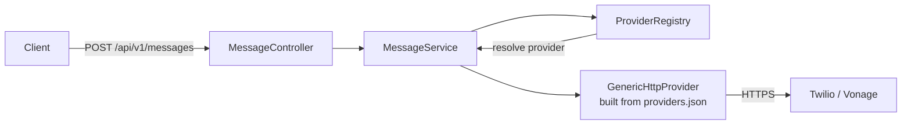
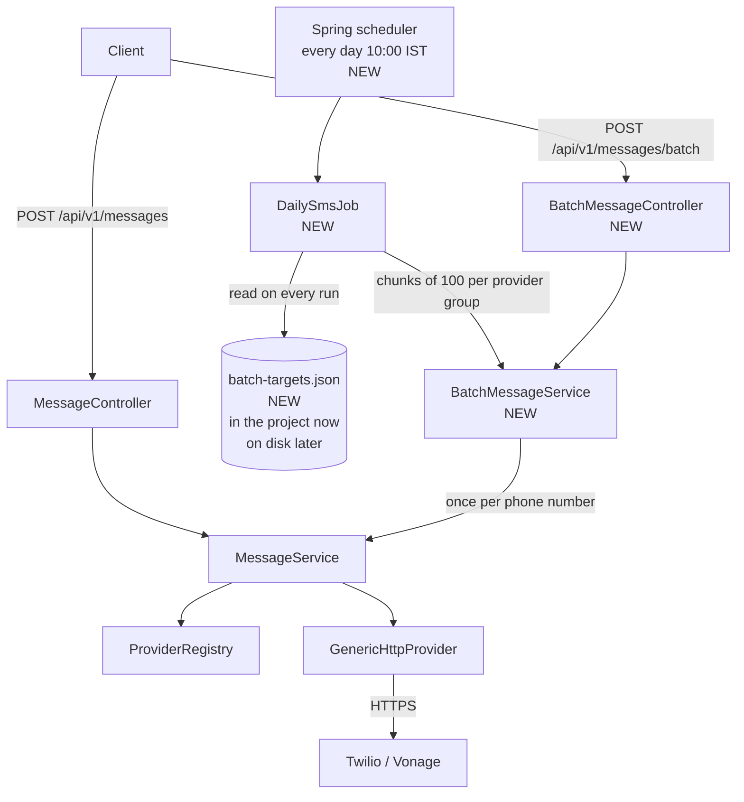
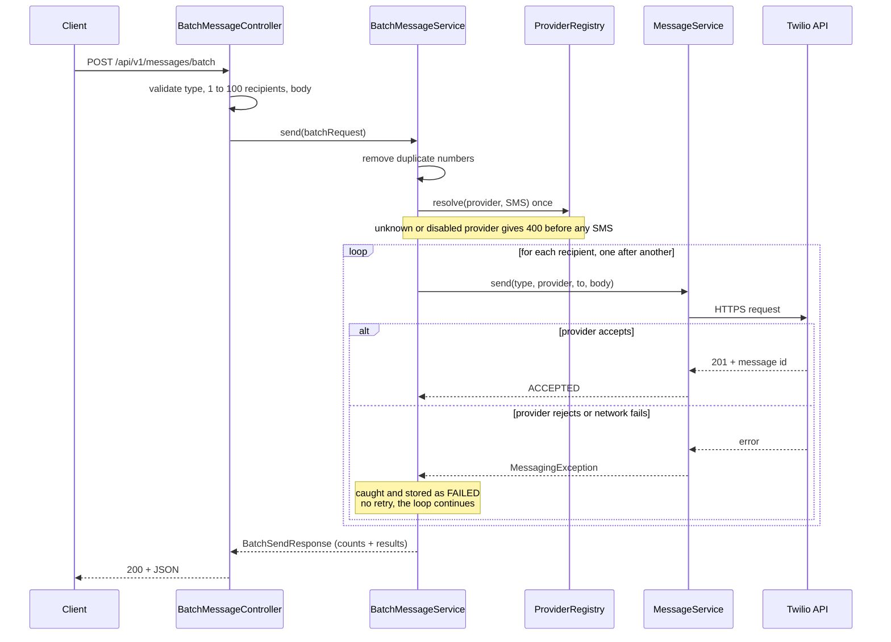
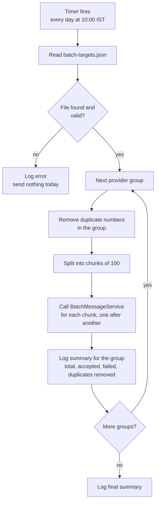
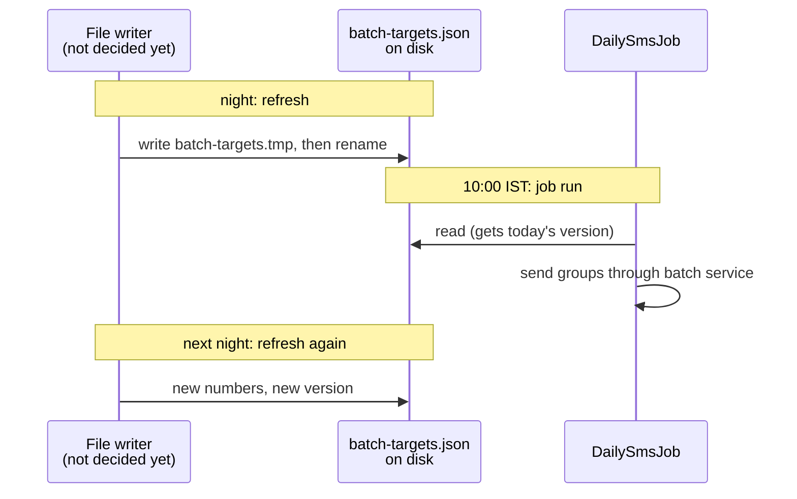
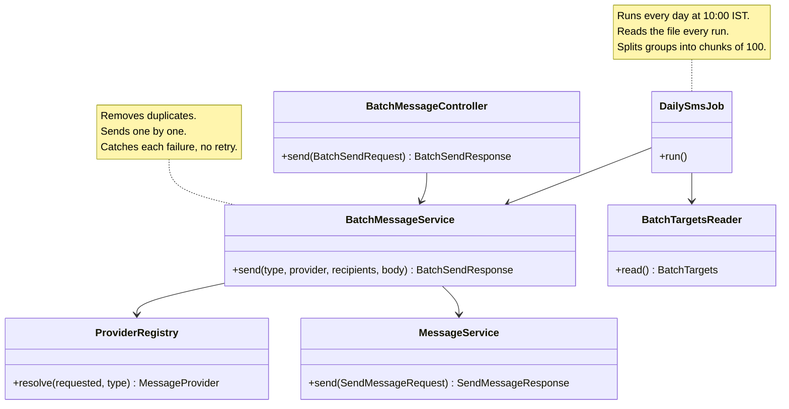

# Batch Sending and the Daily SMS Job

This document explains the new feature before any code is written. All open questions are
answered; the decisions are listed in section 9 and applied throughout the document.

---

## 1. The feature in one paragraph

Today the service sends **one SMS to one phone number** per request. The new feature adds two
things:

1. A **batch API**: one request carries **a list of phone numbers** and one message, and the
   service sends that message to every number, using **one provider** (for example only
   Twilio) for the whole list.
2. A **background job**: it runs by itself **every day at 10:00 IST**, reads a **config file**
   that lists phone numbers **grouped by provider**, and for each group it calls the batch
   service. The config file is meant to be refreshed **every day**, and the job reads it again
   on every run.

Simple picture:

```
 Today:      client ──> POST /api/v1/messages        ──> 1 number      ──> 1 SMS

 Part 1:     client ──> POST /api/v1/messages/batch  ──> up to 100     ──> one SMS each (one provider)

 Part 2:     10:00 IST ──> job reads targets file ──> batch(es) for TWILIO numbers
                                                  ──> batch(es) for VONAGE numbers
```

---

## 2. Real life example

A company wants to send "Your bill is ready" to its customers every morning.

- Every night, someone (a person, a script or another system; not decided yet) prepares the
  file with today's customers, split by which SMS provider should be used for them.
- At 10:00 IST the job wakes up, reads the file, sends the Twilio group through Twilio and the
  Vonage group through Vonage, and logs how many succeeded and failed.
- Separately, an operator can call the batch API by hand, for example to send a one time
  notice to 50 numbers through Vonage.

---

## 3. Where the feature sits in the current code

The current flow (unchanged by this feature):



After the feature (new parts are marked NEW):



Key idea: **nothing below `MessageService` changes.** The batch logic is a loop on top of the
send we already have. Every single SMS still goes through the same tested path
(`MessageService` → `ProviderRegistry` → `GenericHttpProvider`), so masking, logging, error
codes and the providers in `providers.json` all work for batches without extra code.

---

## 4. Part 1: the batch API

### 4.1 What "scoped to a single provider" means

One batch = one provider. All numbers in the request go through the **same** provider. If the
client wants Twilio for some numbers and Vonage for others, it sends **two** batch requests.

Why: it keeps the rules simple (one credential set, one rate limit, one result type) and it
matches how the job works (the file is already grouped by provider).

It also means: **no automatic switching** to another provider when one number fails. If
Twilio rejects number 7, number 7 is reported as failed, not retried through Vonage.

### 4.2 Request

```http
POST /api/v1/messages/batch
Content-Type: application/json
```

```json
{
  "type": "SMS",
  "provider": "TWILIO",
  "recipients": [
    "+910000000001",
    "+910000000002",
    "+910000000003",
    "+910000000001"
  ],
  "body": "Your bill is ready"
}
```

| Field        | Rule                                                                    |
|--------------|-------------------------------------------------------------------------|
| `type`       | Required. Only `SMS` for now (same as the single API).                  |
| `provider`   | Optional. If missing, the channel's primary provider from `providers.json` is used (same as the single API). Fixed for the whole batch. |
| `recipients` | Required. **1 to 100 numbers.** Each one must be E.164 (`+` and 8 to 15 digits), the same pattern the single API uses. More than 100 gives `400` and nothing is sent. |
| `body`       | Required. Same text for every number. Max 1600 characters (same as today). |

**Duplicates:** the same number twice in one list is sent **once**. The response reports how
many were removed (`duplicatesRemoved`). In the example above, `+910000000001` appears twice,
so 3 SMS are sent, not 4.

This rule is safe because every number in a batch gets the same `body`, so a repeated number
would only receive the same SMS twice. If each number gets its own text in the future, this
rule will be revisited.

### 4.3 Response

A batch can be **partly successful**: 2 numbers sent, 1 rejected. So the response says what
happened to **each** number, not just "OK" or "error".

The response shows the **full** phone number for each result, so the caller can match every
result to its number (for example to resend the failed ones). The caller already sent these
numbers, so nothing new is exposed. The **logs stay masked** (`+91******0001`) as today.

```json
{
  "provider": "TWILIO",
  "total": 3,
  "accepted": 2,
  "failed": 1,
  "duplicatesRemoved": 1,
  "results": [
    {
      "to": "+910000000001",
      "status": "ACCEPTED",
      "providerMessageId": "SMxxxxxxxxxxxxxxxx",
      "providerStatus": "queued"
    },
    {
      "to": "+910000000002",
      "status": "ACCEPTED",
      "providerMessageId": "SMyyyyyyyyyyyyyyyy",
      "providerStatus": "queued"
    },
    {
      "to": "+910000000003",
      "status": "FAILED",
      "code": "PROVIDER_REJECTED",
      "providerErrorCode": "21608",
      "detail": "The number is unverified"
    }
  ]
}
```

HTTP status rules:

| Situation                                                       | HTTP status | Why |
|-----------------------------------------------------------------|-------------|-----|
| Request is wrong (bad number format, empty list, more than 100 numbers, unknown provider) | `400` with the usual `ProblemDetail` | Nothing was sent. Same errors as the single API. |
| Request is fine, every number was tried (some may have failed)  | `200` with the body above | The batch itself ran. Per number outcome is inside `results`. |

So the client checks two things: the HTTP status (did the batch run?) and `failed` (did every
number go through?).

**No retries.** A failed number is reported with its error code and is not tried again. The
caller decides whether to resend it. See 4.6.

### 4.4 What happens inside, step by step



The three important rules in this diagram:

1. **Duplicates are removed first**, then the provider is checked **once**, before the loop.
   If the provider name is wrong, nothing is sent and the client gets a `400`.
2. **One failed number never stops the batch.** The error is caught, written into the result
   for that number, and the loop moves to the next number.
3. **Numbers are sent one after another**, not in parallel (see 4.5).

### 4.5 Sending step by step (decided)

Twilio and Vonage do not have a "send this list" endpoint in the APIs we use. A batch of 100
numbers is 100 HTTP calls, made **one after another**.

```
POST /api/v1/messages/batch  (100 numbers)

 number 1   → Twilio → accepted   (~0.5 s)
 number 2   → Twilio → accepted   (~0.5 s)
 number 3   → Twilio → failed     (~0.5 s)  ← noted, continue
 ...
 number 100 → Twilio → accepted   (~0.5 s)

 → one response after all 100 are done (roughly 30 to 100 seconds)
```

| | Step by step (chosen) | Parallel (later, if needed) |
|---|---|---|
| Response time for 100 numbers | 30 to 100 seconds | a few seconds |
| Delivery speed to phones | Same. The provider sends from one number at about 1 SMS per second either way. | Same |
| Provider limits | Never hit by accident | Possible with many parallel calls |
| Logs, code, tests | In order, simple loop | Mixed order, threads, harder to test |

Why step by step for now: on the Twilio trial only a few verified numbers can receive SMS, and
delivery is not faster with parallel calls. Parallel sending (with a small fixed count, for
example 5 at a time) can be added later **inside `BatchMessageService` only**, without
changing the API, the request or the response.

### 4.6 No retries (decided)

The code already tells temporary failures from permanent ones, using the retry rules in
`providers.json` (see `ResponseReader`). Today those rules only choose the error code; nothing
is tried again. The batch feature keeps it that way.

| Failure | Example | Error code | Retried? |
|---|---|---|---|
| Temporary | Twilio `429` or `5xx`, Vonage status `1` or `5` | `PROVIDER_UNAVAILABLE` | No (first version) |
| Network | No answer within 10 s | `PROVIDER_TIMEOUT` | No. The provider may have sent the SMS and only the reply was lost, so a retry could send it twice. |
| Permanent | Unverified or invalid number | `PROVIDER_REJECTED` | No, never useful |

Why: without a database there is no reliable record of what was already sent, and "no retry"
can never cause a double SMS. Retrying `PROVIDER_UNAVAILABLE` a few times can be added later
inside `BatchMessageService`.

---

## 5. Part 2: the background job

### 5.1 What the job does



### 5.2 When the job runs (decided)

**Every day at 10:00 IST**, once.

```properties
messaging.batch-job.cron=0 0 10 * * *
messaging.batch-job.zone=Asia/Kolkata
```

What this means in practice:

| Situation | What happens |
|---|---|
| App is running at 10:00 | The job runs and sends the file. |
| App is down (or asleep on a free hosting tier) at 10:00 | **That day is missed.** Spring's timer does not catch up later. Accepted for now; once a database exists it can store the last run date and catch up missed days. |
| App restarts at 11:00 | Nothing happens. The timer fires only at 10:00, so a restart never causes a second send. |

Because the job runs only once a day, no "already sent this file" check is needed to prevent
duplicate SMS.

### 5.3 The config file

Name: `batch-targets.json`.

```json
{
  "version": "2026-10-20",
  "groups": [
    {
      "provider": "TWILIO",
      "body": "Your bill is ready",
      "recipients": [
        "+910000000001",
        "+910000000002"
      ]
    },
    {
      "provider": "VONAGE",
      "body": "Your order has shipped",
      "recipients": [
        "+910000000003"
      ]
    }
  ]
}
```

| Field                 | Meaning |
|-----------------------|---------|
| `version`             | Label for the file, usually the date it was prepared. The job writes it in the logs so you can see which file was sent. |
| `groups[].provider`   | Provider id, must match an id in `providers.json` (`TWILIO`, `VONAGE`). |
| `groups[].body`       | The text for this group. **Every number in the group gets this exact text.** Different groups can have different text. |
| `groups[].recipients` | Phone numbers in E.164. Any count; the job splits them into chunks of 100. |

Each group becomes one or more batch service calls, 100 numbers at a time:

```
 batch-targets.json                          BatchMessageService.send(...)
 ┌──────────────────────────────┐
 │ group: TWILIO (250 numbers)  │  ───────>  chunk 1: numbers   1 to 100
 │                              │  ───────>  chunk 2: numbers 101 to 200
 │                              │  ───────>  chunk 3: numbers 201 to 250
 ├──────────────────────────────┤
 │ group: VONAGE (3 numbers)    │  ───────>  chunk 1: numbers   1 to 3
 └──────────────────────────────┘
```

Rules for groups:

- **Duplicates are removed per group before splitting**, so a number that appears at position
  5 and again at position 150 is still sent once.
- **The same number in two different groups** (for example under TWILIO and under VONAGE)
  gets two SMS. Each group is a separate batch, and the file writer chose two providers on
  purpose.
- Chunks and groups run **one after another**. A failure in one chunk does not stop the next
  chunk or the next group.

### 5.4 Where the file lives (decided)

**Start inside the project, switch to a file on disk later by changing one setting.**

```properties
# Now: the file is inside the project (src/main/resources/batch-targets.json)
messaging.batch-job.targets-file=classpath:batch-targets.json

# Later: a file on disk that is replaced every day
messaging.batch-job.targets-file=file:./batch-targets.json
```

The reader accepts both `classpath:` and `file:` locations (Spring's `Resource`), so the switch
needs **no code change**. It can also be set with an environment variable, for example
`MESSAGING_BATCHJOB_TARGETSFILE=file:/home/data/batch-targets.json` (the persistent folder on
Azure App Service).

| Stage | Location | How the numbers change |
|---|---|---|
| Now (start) | `src/main/resources/batch-targets.json`, inside the jar | Edit the file, rebuild, redeploy. Good for development and demos. |
| Later | A file on disk, outside the jar | Overwrite the file each night. The next 10:00 run picks it up, no rebuild or restart. |

**Read on every run.** Even while the file is inside the project, the job reads it at the
start of every run and never keeps it in memory between runs. That is what makes the later
switch to a daily refreshed file on disk work without any code change.

**Who refreshes the file:** not decided yet. It is outside this service; the service only reads
the file.

Safe refresh rule for whoever writes the file once it lives on disk: write to a temporary file
first, then rename it to `batch-targets.json`. A rename is instant, so the job never reads a
half written file.



Note: while the file is inside the project, it does not change by itself, so the job sends the
**same numbers every day** at 10:00 until the file is edited and the app is redeployed. The job
is therefore **off by default** (see section 7) and turned on only when wanted.

### 5.5 Errors in the job

| Problem                                  | What the job does |
|------------------------------------------|-------------------|
| File missing or broken JSON               | Logs an error, sends nothing that day. The app keeps running. |
| A group names an unknown or disabled provider | Logs an error for that group, skips it, continues with the other groups. |
| A single number fails                     | Same as the batch API: counted as failed, logged, the rest continue. No retry. |
| The whole provider is down                | Every number in that group fails and is logged. Other groups still run. No retry. |

The job never throws an exception out to Spring's scheduler. It catches everything itself so
the logs always end with a clear summary line.

### 5.6 Job results: logs only (decided)

Nobody waits for a response from the job, so its results go to the **logs only**. Numbers in
the logs are **masked**.

```
10:00:00 INFO  Batch job started: file version 2026-10-20, 2 groups
10:00:41 INFO  TWILIO group done: total=120 accepted=118 failed=2 duplicatesRemoved=1
10:00:41 WARN  TWILIO failed to +91******0003: PROVIDER_REJECTED 21608
10:00:41 WARN  TWILIO failed to +91******0007: PROVIDER_UNAVAILABLE
10:00:55 INFO  VONAGE group done: total=40 accepted=40 failed=0 duplicatesRemoved=0
10:00:55 INFO  Batch job finished: total=160 accepted=158 failed=2
```

Possible later additions, without changing the sending logic: a daily report file, a
`GET /api/v1/batch-job/last-run` endpoint, or an email or chat notification.

### 5.7 How "the job uses the batch API" is done

The job calls **`BatchMessageService` directly**, as a plain Java method call inside the same
app. It does not send an HTTP request to its own `POST /api/v1/messages/batch`.

| | Direct call (chosen) | HTTP call to itself |
|---|---|---|
| Speed | Fast, no network | Extra network hop |
| Setup | Nothing to configure | Needs its own URL and port |
| Tests | Easy | Harder |

Both use **the same batch logic**: the controller is only a thin HTTP layer on top of
`BatchMessageService`, so calling the service directly still "uses the batch API", including
the 100 limit and duplicate removal.

---

## 6. Class structure



Files:

| File | New or changed | Purpose |
|------|----------------|---------|
| `dto/BatchSendRequest.java` | New | Incoming JSON for the batch API, with validation (1 to 100 numbers, E.164). |
| `dto/BatchSendResponse.java` | New | Counts, `duplicatesRemoved`, and per number results with the full number. |
| `controller/BatchMessageController.java` | New | `POST /api/v1/messages/batch`. Or one more method on `MessageController`. |
| `service/BatchMessageService.java` | New | Removes duplicates, resolves the provider once, calls `MessageService` per number. |
| `job/BatchTargets.java` | New | Java shape of `batch-targets.json`. |
| `job/BatchTargetsReader.java` | New | Reads and validates the file from a `classpath:` or `file:` location. Created by the job. |
| `job/DailySmsJob.java` | New | The `@Scheduled` method: groups, chunks of 100, log summaries. Only created when `messaging.batch-job.enabled=true`. |
| `src/main/resources/batch-targets.json` | New | The starting targets file, with fake numbers only. |
| `dto/SendMessageRequest.java` | Changed | The E.164 pattern and its message become shared constants. |
| `MessagingServiceApplication.java` | Changed | Adds `@EnableScheduling`. |
| `application.properties` | Changed | Batch and job settings. |
| Tests for each class above | New | Same style as today: `MockRestServiceServer`, `@WebMvcTest`. |

The settings are read with `@Value` and the `@Scheduled` placeholders, so no separate
properties class is needed.

Not changed: `MessageService` logic, `ProviderRegistry`, `GenericHttpProvider`,
`providers.json`, the single send API.

---

## 7. Settings

```properties
# Max numbers in one batch API call. The job splits bigger groups into chunks of this size.
messaging.batch.max-recipients=100

# Background job. Off by default so tests and local runs never send SMS by accident.
messaging.batch-job.enabled=false
# Spring cron: second minute hour day month weekday. Every day at 10:00.
messaging.batch-job.cron=0 0 10 * * *
messaging.batch-job.zone=Asia/Kolkata
# classpath: = inside the project (now). file: = on disk (later, refreshed daily).
messaging.batch-job.targets-file=classpath:batch-targets.json
```

Each of these can be overridden with an environment variable on any host, for example
`MESSAGING_BATCHJOB_ENABLED=true`.

---

## 8. Known limits of the first version

These are accepted for now and can be fixed later, mostly once a database exists.

1. **A missed 10:00 is not caught up.** If the app is down or asleep at 10:00, that day's SMS
   are not sent.
2. **No retries.** Temporary provider errors are logged, not tried again.
3. **No resume.** If the app crashes in the middle of a run, the rest of that day's numbers are
   not sent, and nothing records which ones were already sent.
4. **One app instance only.** With two or more copies of the app running, each copy would run
   the job and every number would get the SMS twice. That would need a shared lock (for
   example ShedLock with a database).
5. **The starting file is inside the project.** It changes only with a rebuild and redeploy
   until the setting is switched to a file on disk.
6. **Results are in the logs only.** There is no report file, endpoint or notification yet.

---

## 9. Decisions

| # | Question | Decision |
|---|----------|----------|
| 1 | Message text for the job | One `body` per group in the file. Every number in a group gets the same text. Personal text per number can come later; that would also change the batch API to take number and message pairs. |
| 2 | When the job runs | Every day at **10:00 IST**, once. If the app is down at that time, the day is missed. Accepted until a database exists. |
| 3 | Where the file lives | **Start inside the project** (`classpath:batch-targets.json`), **switch to a file on disk** (`file:...`) by changing one setting. No code change needed. Who refreshes the file: not decided yet. |
| 4 | Batch size | **100 numbers** per batch call. The job splits bigger groups into chunks of 100. Numbers are sent **one after another**, not in parallel. |
| 5 | Duplicates in one list | **Sent once.** The response reports `duplicatesRemoved`. Revisit if each number gets its own text. |
| 6 | Numbers in the response | **Full number** in the batch response. Logs stay masked. |
| 7 | Retries | **None** in the first version. Failures are reported and logged. |
| 8 | Where job results go | **Logs only.** |

---

## 10. Words used in this document

| Word | Meaning |
|------|---------|
| Batch | One request that sends the same message to many numbers. |
| Recipient | One phone number in a batch. |
| Provider group | The numbers in the config file that must go through one provider. |
| Chunk | A slice of at most 100 numbers from a provider group, sent as one batch. |
| Partial success | Some numbers sent, some failed, in the same batch. |
| Background job | Code that runs by itself on a timer, not because a client called the API. |
| Cron | A schedule written as text, for example `0 0 10 * * *` = every day at 10:00. |
| `classpath:` / `file:` | Spring prefixes: `classpath:` reads from inside the project (the jar), `file:` reads from the disk. |
| E.164 | Phone number format: `+`, country code, number, no spaces. |
