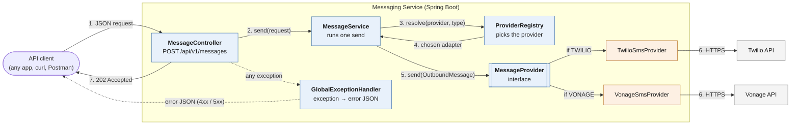
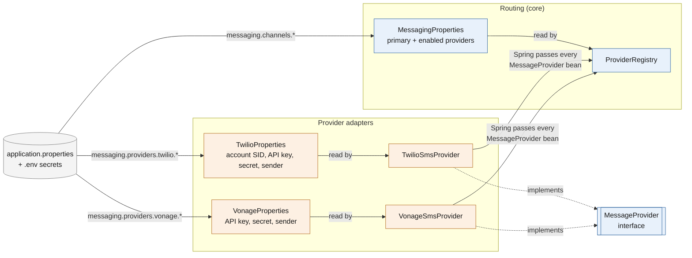
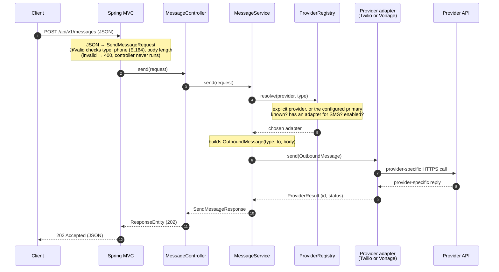

# Messaging Service: Demo Guide

**One API to send SMS through any provider.** Today: Twilio and Vonage. Built so more providers
(Plivo, ...) and channels (WhatsApp, Email) can be added without touching the core.

| | |
|---|---|
| Stack | Java 21, Spring Boot 4.1, Spring MVC, Bean Validation, `RestClient` |
| Endpoint | `POST /api/v1/messages` |
| Providers | Twilio (working), Vonage (working) |
| Tests | 81 automated tests, no real provider calls |
| Design doc | [design.md](design.md) |

---

## 1. The problem and the goal

**Problem.** Every SMS provider has its own API: different URLs, field names, phone formats, login
and error styles. If every team calls Twilio or Vonage directly, switching providers or adding a
second one means changing code everywhere.

**Goal.** One internal API with one request format, one response format and one error format. The
caller just says *what* to send; the service decides *how* and *through whom*.

```text
Before                                  After
──────                                  ─────
App A ──► Twilio API                    App A ──┐
App B ──► Vonage API                    App B ──┼──► Messaging Service ──┬──► Twilio
App C ──► Twilio API (again)            App C ──┘    (one API)           └──► Vonage
```

---

## 2. Architecture

### 2.1 Big picture: one request



How to read it:

- **Solid arrows** are the calls of one successful request, in order (1 to 7). At step 5 the
  service calls the interface; at runtime that runs **exactly one** adapter, the one the registry
  picked, so only one of the two step-6 arrows happens.
- **Dotted arrows** are the error path. An error can start in validation (before the controller),
  in the registry, the service or an adapter. It travels back up through the controller, and
  `GlobalExceptionHandler` turns it into one error JSON.
- **Blue = shared core** (written once, provider-neutral). **Orange = provider adapters** (the only
  code that knows a provider).

### 2.2 Big picture: what is wired at startup



- The **registry** reads only the **routing** (which provider is the default, which are enabled).
- Each **adapter** reads only **its own credentials**. The core never sees Twilio or Vonage secrets.
- Spring hands every `@Component` that implements `MessageProvider` to the registry. The registry
  indexes them by channel and `id()` and checks the configuration. If anything is wrong, the app
  does not start.

### 2.3 The layers

```text
┌──────────────────────────────────────────────────────────────────────────┐
│  API LAYER        MessageController, GlobalExceptionHandler              │  receive, validate, respond
│                   SendMessageRequest, SendMessageResponse                │
├──────────────────────────────────────────────────────────────────────────┤
│  SERVICE LAYER    MessageService, ProviderRegistry, MessagingProperties  │  pick provider, run the send
├──────────────────────────────────────────────────────────────────────────┤
│  CONTRACT         MessageProvider (interface)                            │  the boundary between core
│                   OutboundMessage, ProviderResult                        │  and adapters
├──────────────────────────────────────────────────────────────────────────┤
│  ADAPTERS         TwilioSmsProvider        VonageSmsProvider             │  speak each provider's API
│                   TwilioProperties         VonageProperties              │
├──────────────────────────────────────────────────────────────────────────┤
│  EXTERNAL         Twilio REST API          Vonage SMS API                │
└──────────────────────────────────────────────────────────────────────────┘
  Used by every layer: MessageType (SMS), MessagingException + ErrorCode (errors)
```

**Rules:**

- Calls only go **downward**: controller → service → interface → adapter → provider API.
- The service reaches a provider **only through the `MessageProvider` interface**. Nothing outside
  `provider/twilio/` and `provider/vonage/` imports their classes (they are not even `public`).

### 2.4 The key idea: one contract, many providers

```java
public interface MessageProvider {
    String id();                               // "TWILIO", "VONAGE"
    Set<MessageType> supportedTypes();         // [SMS]
    default boolean isConfigured() {           // credentials present?
        return true;                           //   (each adapter overrides this)
    }
    ProviderResult send(OutboundMessage msg);  // send one message
}
```

```text
                      MessageService
                           │  provider.send(message)
                           ▼
                 ┌───────────────────┐
                 │  MessageProvider  │
                 └─────────┬─────────┘
                           │  at runtime the call goes to exactly ONE of these
          ┌────────────────┼──────────────────┬──────────────────────┐
          ▼                ▼                  ▼                      ▼
   TwilioSmsProvider  VonageSmsProvider  PlivoSmsProvider    TwilioWhatsAppProvider
       (today)            (today)          (future)              (future)
```

At startup Spring creates every `@Component` class that implements `MessageProvider` and passes
them all to the `ProviderRegistry` constructor, which indexes them by channel and `id()`. Adding a
provider = adding one class. **No existing code changes.**

---

## 3. How one request flows



In plain words:

1. **Receive and validate.** Wrong input is rejected with `400` before any provider is touched.
2. **Select.** Use the provider named in the request, or the configured default (primary).
3. **Translate and send.** The adapter converts our neutral message into the provider's format.
4. **Respond.** Same response shape whichever provider was used.

---

## 4. Code structure

```text
src/main/java/com/example/messaging_service/
├── MessagingServiceApplication.java      Spring Boot entry point
│
├── controller/
│   └── MessageController.java            POST /api/v1/messages (thin: validate, call, return 202)
│
├── dto/                                  JSON shapes, no logic
│   ├── SendMessageRequest.java           request + validation rules
│   ├── SendMessageResponse.java          success response
│   └── MessageType.java                  enum: SMS (WhatsApp/Email later)
│
├── service/                              shared logic, never names a provider
│   ├── MessageService.java               the send flow, network-error mapping, logging
│   └── ProviderRegistry.java             picks the provider, checks config at startup
│
├── provider/                             the contract
│   ├── MessageProvider.java              interface every provider implements
│   ├── OutboundMessage.java              what we give a provider
│   ├── ProviderResult.java               what a provider gives back
│   ├── twilio/                           ── everything Twilio, nothing else
│   │   ├── TwilioSmsProvider.java
│   │   └── TwilioProperties.java
│   └── vonage/                           ── everything Vonage, nothing else
│       ├── VonageSmsProvider.java
│       └── VonageProperties.java
│
├── exception/                            all error handling in one place
│   ├── ErrorCode.java                    every error code + HTTP status
│   ├── MessagingException.java           the one exception we throw
│   └── GlobalExceptionHandler.java       exception → error JSON
│
└── config/
    └── MessagingProperties.java          routing: primary + enabled providers per channel

src/main/resources/application.properties all settings; secrets come from .env / env vars
src/test/java/...                         81 tests, same folders as main
```

| Folder | Responsibility | Changes when adding a provider? |
|---|---|---|
| `controller/` | HTTP in and out | No |
| `dto/` | Request and response shapes | No |
| `service/` | Send flow, provider selection | No |
| `provider/` | The contract | No |
| `provider/<name>/` | One provider's adapter | **Yes, new folder** |
| `exception/` | Error codes and format | No |
| `config/` | Routing settings | No |

---

## 5. API contract

### Request

```json
POST /api/v1/messages
{
  "type": "SMS",
  "provider": "TWILIO",
  "to": "+919876543210",
  "body": "Your verification code is 482913"
}
```

| Field | Required | Rule |
|---|---|---|
| `type` | yes | `SMS` (any letter case) |
| `provider` | no | `TWILIO` or `VONAGE`; if omitted, the configured primary is used |
| `to` | yes | E.164 format: `+`, country code, number |
| `body` | yes | not blank, max 1600 characters |

### Success: `202 Accepted`

```json
{
  "status": "ACCEPTED",
  "provider": "TWILIO",
  "providerMessageId": "SM2c7f9a1e0b3d4c5e6f7a8b9c0d1e2f3a",
  "providerStatus": "queued",
  "acceptedAt": "2026-10-15T10:15:30Z"
}
```

`202` (not `200`) on purpose: the provider **accepted** the SMS. Delivery to the phone happens later.

### Errors: one format for everything

```json
{
  "title": "Provider rejected the message",
  "status": 502,
  "detail": "Twilio rejected the message: The 'To' number is not a valid phone number.",
  "instance": "/api/v1/messages",
  "code": "PROVIDER_REJECTED",
  "provider": "TWILIO",
  "providerErrorCode": "21211"
}
```

| `code` | HTTP | When |
|---|---|---|
| `VALIDATION_FAILED` | 400 | bad phone, empty body, unknown type, broken JSON |
| `UNSUPPORTED_PROVIDER` | 400 | unknown provider name |
| `UNSUPPORTED_MESSAGE_TYPE` | 400 | provider cannot send this channel |
| `PROVIDER_UNAVAILABLE` | 503 | provider disabled, unreachable, throttled, or down |
| `PROVIDER_TIMEOUT` | 504 | no answer in time; message may or may not be sent |
| `PROVIDER_REJECTED` | 502 | provider refused (bad number, auth, trial limits) |
| `INTERNAL_ERROR` | 500 | unexpected; details only in logs |

Clients switch on `code`, which is stable. Provider-specific codes are passed through in
`providerErrorCode` for debugging.

---

## 6. Twilio vs Vonage: same input, different adapters

| | Twilio | Vonage |
|---|---|---|
| Endpoint | `api.twilio.com/.../Messages.json` | `rest.nexmo.com/sms/json` |
| Login | API key + secret | API key + secret |
| Fields | `To`, `From`, `Body` | `from`, `to`, `text` |
| Phone format | `+919876543210` | `919876543210` (adapter strips `+`) |
| Hindi / emoji | automatic | adapter adds `type=unicode` |
| Success | HTTP `201` | HTTP `200` + `status: "0"` |
| Failure | HTTP `4xx` | **HTTP `200`** + non-zero `status` |

All of these differences live **inside each adapter**. The client and the core never see them.

---

## 7. Configuration and secrets

```properties
# Routing (application.properties)
messaging.channels.sms.primary-provider=TWILIO          # default when request has no provider
messaging.channels.sms.enabled-providers=TWILIO,VONAGE  # who may send

# Credentials: placeholders filled from .env or environment variables
messaging.providers.twilio.account-sid=${TWILIO_ACCOUNT_SID:}
messaging.providers.twilio.api-key=${TWILIO_API_KEY:}
...
```

- **Secrets are never in code or git.** Locally they live in `.env` (git-ignored); on servers they
  come from environment variables.
- **Switch the default provider with no code change:** `MESSAGING_CHANNELS_SMS_PRIMARYPROVIDER=VONAGE`.
- **Take a provider out of service:** remove it from `enabled-providers`; requests naming it get
  `503`.
- **Fail fast:** if config is wrong (missing credentials, typo in a provider name, disabled
  primary), the app **refuses to start** with a clear message. A request never fails because of
  bad config.

```text
Invalid messaging configuration:
 - VONAGE is enabled for SMS but its credentials are missing (messaging.providers.vonage.*)
```

---

## 8. Live demo script

**Setup:** `.env` filled with Twilio and Vonage values. Start the service:

```bash
./mvnw spring-boot:run
```

Point out the startup log line:

```text
SMS adapters [TWILIO, VONAGE], enabled [TWILIO, VONAGE], primary TWILIO
```

### Demo 1: send through Twilio

```bash
curl -i -X POST http://localhost:8080/api/v1/messages -H 'Content-Type: application/json' -d '{ "type": "SMS", "provider": "TWILIO", "to": "+91XXXXXXXXXX", "body": "Demo: sent via Twilio" }'
```

Expect `202`, `"provider": "TWILIO"`, an `SM...` id. Phone receives the SMS.

### Demo 2: same request, Vonage (only one word changes)

```bash
curl -i -X POST http://localhost:8080/api/v1/messages -H 'Content-Type: application/json' -d '{ "type": "SMS", "provider": "VONAGE", "to": "+91XXXXXXXXXX", "body": "Demo: sent via Vonage" }'
```

Expect `202`, `"provider": "VONAGE"`.

### Demo 3: no provider given, the primary is used

```bash
curl -i -X POST http://localhost:8080/api/v1/messages -H 'Content-Type: application/json' -d '{ "type": "sms", "to": "+91XXXXXXXXXX", "body": "Demo: default provider" }'
```

Expect `"provider": "TWILIO"` (the primary). Note `"sms"` in lowercase is accepted.

### Demo 4: validation, nothing reaches a provider

```bash
curl -i -X POST http://localhost:8080/api/v1/messages -H 'Content-Type: application/json' -d '{ "type": "SMS", "to": "98765", "body": "" }'
```

Expect `400 VALIDATION_FAILED` with a list of field errors.

### Demo 5: unknown provider

```bash
curl -i -X POST http://localhost:8080/api/v1/messages -H 'Content-Type: application/json' -d '{ "type": "SMS", "provider": "SINCH", "to": "+91XXXXXXXXXX", "body": "Hi" }'
```

Expect `400 UNSUPPORTED_PROVIDER`: "Supported providers: TWILIO, VONAGE."

### Demo 6: switch the default provider with no code change

Stop the app, then:

```bash
MESSAGING_CHANNELS_SMS_PRIMARYPROVIDER=VONAGE ./mvnw spring-boot:run
```

Repeat Demo 3. Now `"provider": "VONAGE"`.

### Demo 7: tests

```bash
./mvnw test
```

81 tests pass, with no real SMS sent and no credentials needed.

---

## 9. How we add things later

### A new provider (e.g. Plivo): no core changes

```text
provider/
├── twilio/
├── vonage/
└── plivo/                       ← NEW folder
    ├── PlivoSmsProvider.java    implements MessageProvider
    └── PlivoProperties.java     credentials
+ 3 lines in application.properties, + PLIVO in enabled-providers
```

### A new channel (e.g. WhatsApp via Twilio): small, planned core change

| Change | Where |
|---|---|
| Add `WHATSAPP` to the enum | `MessageType.java` (1 line) |
| New adapter `TwilioWhatsAppProvider` (same Twilio API, `whatsapp:` prefix) | `provider/twilio/` |
| Routing for the new channel | `messaging.channels.whatsapp.*` |

The registry is keyed by **channel + provider**, so Twilio SMS and Twilio WhatsApp live side by side
without clashing.

---

## 10. Quality and testing

| Test class | What it proves |
|---|---|
| `MessageControllerTest` | 202 response shape, every validation error, every error code's JSON |
| `ProviderRegistryTest` | provider selection rules, every startup failure case |
| `MessageServiceTest` | send flow; real network tests: refused connection → 503, silent server → 504 |
| `TwilioSmsProviderTest` | exact URL, auth header, form fields; success and error mapping |
| `VonageSmsProviderTest` | `+` stripping, Unicode detection, "HTTP 200 but failed" handling |
| `MessagingServiceApplicationTests` | whole app wired together, HTTP client and timeouts |
| `MessagingPropertiesTest`, `MessageTypeTest`, `ErrorCodeTest` | config binding, case-insensitive type, status table |

Other safeguards: phone numbers are **masked in logs** (`+91******3210`), message bodies are
**never logged**, credentials and stack traces are **never returned** to clients.

---

## 11. Design decisions (likely questions)

| Question | Answer |
|---|---|
| Why an interface for providers? | The core never changes when providers change. Each provider is isolated; changing Vonage cannot break Twilio. |
| Why plain HTTP instead of Twilio/Vonage SDKs? | One HTTP client, one timeout config and one error mapping for all providers; easy to test without network; no extra libraries. An adapter can switch to an SDK later without affecting anything else. |
| Why `202` and not `200`? | Honest: the provider accepted the SMS; delivery is confirmed later. |
| What if Twilio is down? | Client gets `503 PROVIDER_UNAVAILABLE` (or `504` on timeout). No silent fallback in this version. |
| Why fail at startup on bad config? | Mistakes are found at deploy time, not by a customer's request. |
| Are secrets safe? | Only in `.env` (git-ignored) or environment variables. Never in code, logs or responses. |

---

## 12. Status and next steps

**Done**

- One endpoint, SMS through Twilio and Vonage, both tested with real SMS
- Validation, provider selection, configurable default provider
- Consistent success and error responses
- Fail-fast configuration checks, secrets outside the code
- 81 automated tests, plus detailed docs ([twilio-flow.md](twilio-flow.md),
  [twilio-call-trace.md](twilio-call-trace.md), [vonage-flow.md](vonage-flow.md))

**Not in this version (planned in the design)**

| Next step | Why it matters |
|---|---|
| Authentication (API keys) | only trusted apps may send |
| Delivery tracking (webhooks) + database | know if the phone actually received it |
| Automatic fallback / retries | send via Vonage when Twilio is down |
| WhatsApp and Email channels | the structure is already prepared |
| Rate limiting, templates, scheduling | product features on top of the same core |
