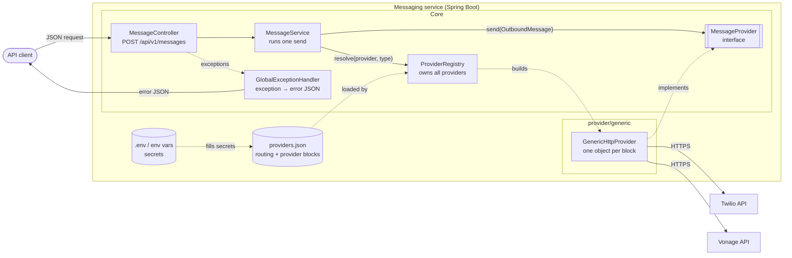
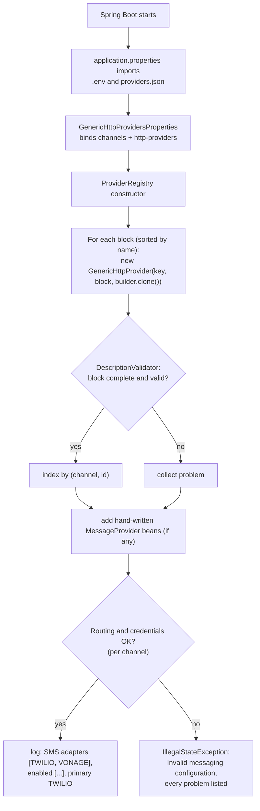
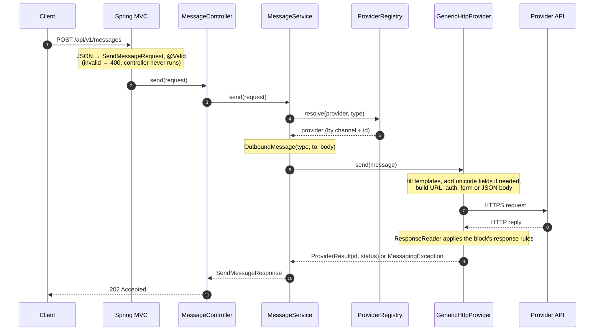
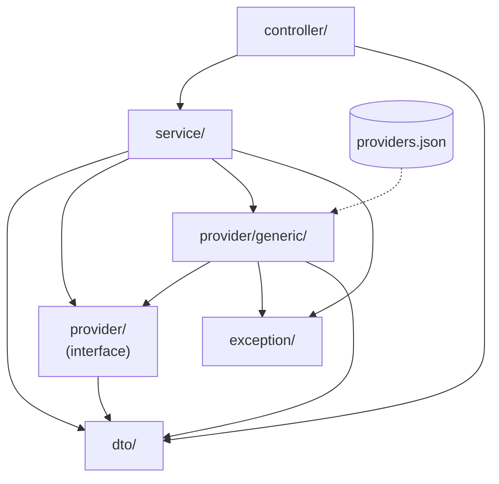
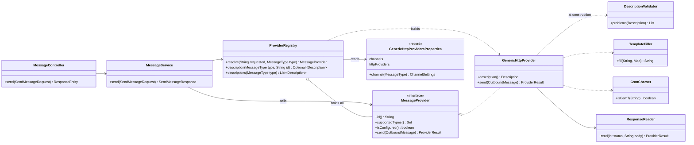
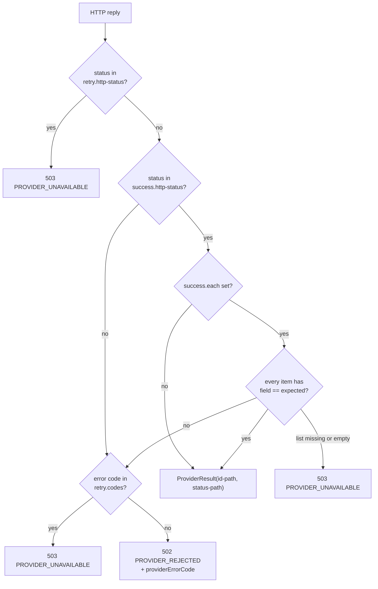

# Messaging Platform: Design Document v2

| Item | Value |
|---|---|
| Status | Implemented (branch `develop`, merged to `main`) |
| Date | 2026-10-15 |
| Supersedes | [design.md](design.md) (v1, one Java adapter per provider) |
| Scope | SMS through Twilio and Vonage. Providers are described in configuration, so more providers (and later channels) can be added mostly without code. |
| Stack | Java 21, Spring Boot 4.1.x (Spring MVC, Bean Validation, `RestClient`, Jackson 3), Jayway JSONPath |

## Change history

| Version | What changed | Why |
|---|---|---|
| v1 | One endpoint, shared core, **one Java adapter class per provider** (`TwilioSmsProvider`, `VonageSmsProvider`) with its own properties class. Routing in `application.properties`. | First working version. |
| **v2** | **Generic HTTP provider**: one engine (`GenericHttpProvider`) runs every provider from a **JSON block** in `providers.json`. The Java adapters were removed after parity tests proved identical behaviour. | Reuse: auth, body building, error mapping and retries are written once. A new provider is configuration, not code. |
| **v2** | **`providers.json` merged into `ProviderRegistry`**: routing moved into `providers.json`; the registry loads it, builds the providers itself, and can **give back each provider's block** (secrets masked). | One file and one owner for everything about providers. |

What did **not** change from v1: the API contract, the error format and codes, the request flow
through controller and service, the provider selection rules, the `MessageProvider` interface, and
the design reasoning in v1 sections 5.6 (accepted is not delivered) and 9 (most decisions).

## Contents

0. [Summary and scope](#0-summary-and-scope)
1. [Architecture](#1-architecture)
2. [Request flow and startup](#2-request-flow-and-startup)
3. [Java structure](#3-java-structure)
4. [Configuration](#4-configuration)
5. [The generic HTTP provider](#5-the-generic-http-provider)
6. [Shared vs provider-specific](#6-shared-vs-provider-specific)
7. [API contract](#7-api-contract)
8. [Extensibility](#8-extensibility)
9. [Testing](#9-testing)
10. [Design decisions and trade-offs](#10-design-decisions-and-trade-offs)
11. [Known limits and next steps](#11-known-limits-and-next-steps)
12. [Out of scope](#12-out-of-scope)

---

## 0. Summary and scope

One HTTP endpoint accepts a provider-neutral message and sends it through a chosen SMS provider.
The service has three parts:

- **The core** (`controller`, `service`, `exception`, `dto`, the `MessageProvider` interface):
  validation, provider selection, calling the provider, the response, one error format.
- **The generic engine** (`provider/generic`): one class that can call any REST SMS API described
  in configuration, and read its reply.
- **The provider descriptions** (`providers.json`): one JSON block per provider (URL, login, body
  fields, reply rules), plus routing per channel.

Adding a normal REST provider means adding one JSON block. A provider that cannot be described in
JSON (vendor SDK, JWT signing) can still be a Java class implementing `MessageProvider`.

**In scope:** `POST /api/v1/messages` for `type: SMS`; validation; provider selection (explicit or
primary); Twilio and Vonage as JSON blocks; consistent success and error responses; startup checks
of the whole configuration; reading back provider descriptions with secrets masked.

**Out of scope:** see [section 12](#12-out-of-scope).

---

## 1. Architecture



### Components and responsibilities

| Component | Responsibility | Knows about specific providers? |
|---|---|---|
| `MessageController` | Receives the request, triggers validation, calls the service, returns `202`. | No |
| `GlobalExceptionHandler` | Turns every exception into one `ProblemDetail` JSON with a stable `code`. | No |
| `MessageService` | Runs one send: resolve the provider, build the `OutboundMessage`, call it, map network failures, log, build the response. | No (only the interface) |
| `ProviderRegistry` | Loads routing and provider blocks, **builds one `GenericHttpProvider` per block**, adds hand-written provider beans, applies selection rules, checks everything at startup, **gives back blocks with secrets masked**. | Knows the generic engine and `providers.json`, never a specific provider |
| `MessageProvider` | The contract every provider implements: `id()`, `supportedTypes()`, `isConfigured()`, `send()`. | It is the boundary |
| `GenericHttpProvider` | Turns a message into the HTTP call its block describes, and the reply into a result or error. | No; all provider knowledge is data in its block |
| `providers.json` | Routing per channel, and one block per provider. | Yes, as data only |
| `.env` / environment variables | Secrets and sender numbers, referenced from blocks as `${VAR:}`. | Values only |

**Dependency rule:** the controller calls the service; the service talks to providers only through
`MessageProvider`. The registry is the only core class that knows the generic engine. No Java class
names Twilio or Vonage.

---

## 2. Request flow and startup

### 2.1 Startup



Two layers of startup checks:

| Layer | Checks | Example message |
|---|---|---|
| Block (`DescriptionValidator`) | id, channels, method, URL, auth, body, placeholders, JSONPath, status patterns | `Invalid messaging.http-providers.vonage: request.url is missing` |
| Registry | duplicate (channel, id), id upper case, channel block exists, primary has a provider and is enabled, enabled ids exist, enabled providers have every variable filled | `VONAGE is enabled for SMS but its credentials are missing` |

A bad configuration stops the deploy; it never fails a customer's request.

### 2.2 One request



### 2.3 Provider selection rules (unchanged from v1)

1. `provider` present and not blank → normalize (trim, upper case); otherwise use the channel's
   `primary-provider`.
2. Unknown id → `400 UNSUPPORTED_PROVIDER`.
3. Known, but no provider for this channel → `400 UNSUPPORTED_MESSAGE_TYPE`.
4. Not in the channel's `enabled-providers` → `503 PROVIDER_UNAVAILABLE`.
5. Otherwise send. No silent fallback to another provider.

---

## 3. Java structure

### 3.1 Project layout

```text
messaging-service/
├── pom.xml
├── README.MD
├── .env.example                          variable names, no values (committed)
├── docs/
│   ├── design.md                         v1 design
│   └── design-v2.md                      this document
└── src/
    ├── main/
    │   ├── java/com/example/messaging_service/
    │   │   ├── MessagingServiceApplication.java    entry point, @ConfigurationPropertiesScan
    │   │   ├── controller/
    │   │   │   └── MessageController.java
    │   │   ├── dto/
    │   │   │   ├── SendMessageRequest.java
    │   │   │   ├── SendMessageResponse.java
    │   │   │   └── MessageType.java
    │   │   ├── service/
    │   │   │   ├── MessageService.java
    │   │   │   └── ProviderRegistry.java
    │   │   ├── provider/
    │   │   │   ├── MessageProvider.java
    │   │   │   ├── OutboundMessage.java
    │   │   │   ├── ProviderResult.java
    │   │   │   └── generic/
    │   │   │       ├── GenericHttpProvider.java
    │   │   │       ├── GenericHttpProvidersProperties.java
    │   │   │       ├── DescriptionValidator.java
    │   │   │       ├── TemplateFiller.java
    │   │   │       ├── ResponseReader.java
    │   │   │       └── GsmCharset.java
    │   │   └── exception/
    │   │       ├── ErrorCode.java
    │   │       ├── MessagingException.java
    │   │       └── GlobalExceptionHandler.java
    │   └── resources/
    │       ├── application.properties    timeouts; imports .env and providers.json
    │       └── providers.json            routing + provider blocks
    └── test/java/com/example/messaging_service/   same folders as main
```

**19 Java files** in `main` (v1 had 18, with 4 of them provider-specific).

### 3.2 What goes in each folder

| Folder | Holds | Changes when adding a provider? |
|---|---|---|
| `controller/` | REST endpoint | No |
| `dto/` | Request and response shapes | No |
| `service/` | Send flow, provider registry | No |
| `provider/` | The contract | No |
| `provider/generic/` | The engine for configured providers | No (only when the engine gains a new kind of setting) |
| `exception/` | Error codes, exception, handler | No |
| `resources/providers.json` | Provider blocks and routing | **Yes: one new block** |

### 3.3 How the folders depend on each other



The only new edge compared with v1 is `service → provider/generic`: the registry builds the generic
providers and returns their descriptions.

### 3.4 Class diagram



### 3.5 Role of each class

| Folder | Class | Kind | Role |
|---|---|---|---|
| `controller` | `MessageController` | `@RestController` | `@Valid` request, calls the service, returns `202`. |
| `dto` | `SendMessageRequest` | record | `type`, `provider` (optional), `to`, `body`, with validation rules. |
| `dto` | `SendMessageResponse` | record | Success body. |
| `dto` | `MessageType` | enum | `SMS`; accepts any letter case. |
| `service` | `MessageService` | `@Service` | The send flow; maps network failures (could not connect → 503, no reply → 504); logs with a masked number. |
| `service` | `ProviderRegistry` | `@Component` | Builds providers from `providers.json`, adds hand-written provider beans, selection rules, startup checks, `description()` / `descriptions()` with masked secrets. |
| `provider` | `MessageProvider` | interface | The extension point. |
| `provider` | `OutboundMessage`, `ProviderResult` | records | Provider-neutral message and reply. |
| `provider/generic` | `GenericHttpProvider` | class | One per block. Builds and sends the request; hands the reply to `ResponseReader`. |
| `provider/generic` | `GenericHttpProvidersProperties` | `@ConfigurationProperties("messaging")` | Model of `providers.json`: `channels` and `httpProviders` (with `Description`, `Request`, `Auth`, `Body`, `Response`, `Success`, `Retry` records). |
| `provider/generic` | `DescriptionValidator` | utility | All startup checks of one block. |
| `provider/generic` | `TemplateFiller` | utility | Fills `{{placeholders}}` in one pass, so message text can never inject a placeholder. |
| `provider/generic` | `ResponseReader` | class | Applies the block's response rules: success, each-item check, id, errors, retry. |
| `provider/generic` | `GsmCharset` | utility | Is this text plain GSM-7? |
| `exception` | `ErrorCode`, `MessagingException`, `GlobalExceptionHandler` | enum, exception, advice | One error table, one exception, one handler. |

---

## 4. Configuration

### 4.1 Files

| File | Holds | Committed |
|---|---|---|
| `src/main/resources/providers.json` | `messaging.channels` (routing) and `messaging.http-providers` (blocks) | yes |
| `src/main/resources/application.properties` | HTTP timeouts (2s connect, 10s read, JDK client); imports `.env` and `providers.json` | yes |
| `.env` | Secrets and sender values | **no** (git-ignored) |
| `.env.example` | Variable names without values | yes |

`application.properties` imports the files:

```properties
spring.config.import=optional:file:.env[.properties],classpath:providers.json[.yaml]
```

`[.yaml]` makes Spring read the JSON with its YAML loader (JSON is a subset of YAML). Real
environment variables override both files.

### 4.2 `providers.json` structure

```json
{
  "messaging": {
    "channels": {
      "sms": { "primary-provider": "TWILIO", "enabled-providers": ["TWILIO", "VONAGE"] }
    },
    "http-providers": {
      "twilio": { "...": "one block, see 4.3" },
      "vonage": { "...": "one block" }
    }
  }
}
```

### 4.3 Block reference

| Setting | Meaning | Default |
|---|---|---|
| `id` | Provider id in requests and routing, upper case | required |
| `display-name` | Name in error messages | the id |
| `channels` | Channels it can send, e.g. `["SMS"]` | required |
| `variables` | Secrets and settings, usually `"${ENV_VAR:}"`; all must be filled when enabled | none |
| `request.method` | `POST`, `PUT` or `PATCH` | required |
| `request.url` | Absolute URL; may use variables only, never message values | required |
| `request.auth.type` | `basic` (`username`, `password`), `bearer` (`token`), `header` (`header-name`, `header-value`), `none` | required |
| `request.body.format` | `form` or `json` | required |
| `request.body.fields` | Field name → template | required |
| `request.body.unicode-fields` | Fields added only when the text is not GSM-7 | none |
| `response.success.http-status` | Statuses that may mean success | `["2xx"]` |
| `response.success.each`, `field`, `expected` | Every item at `each` must have `field == expected` (replies where HTTP 200 can still fail) | off |
| `response.id-path`, `status-path` | JSONPath to the message id and provider status | `id-path` required |
| `response.error.code-path`, `message-path` | JSONPath to the error code and text | none |
| `response.retry.http-status`, `codes` | What means "try later" | `["429", "5xx"]`, none |

Placeholders: `{{to}}` (E.164 with `+`), `{{to_digits}}` (without `+`), `{{text}}`, and
``.

### 4.4 Twilio and Vonage as blocks

| Difference | Twilio block | Vonage block |
|---|---|---|
| URL | `https://api.twilio.com/2010-04-01/Accounts/{{account-sid}}/Messages.json` | `https://rest.nexmo.com/sms/json` |
| Auth | `basic`, `{{api-key}}` / `{{api-secret}}` | `basic`, `{{api-key}}` / `{{api-secret}}` |
| Body | `form`: `To={{to}}`, `From={{from}}`, `Body={{text}}` | `form`: `from={{from}}`, `to={{to_digits}}`, `text={{text}}` |
| Unicode | not needed | `unicode-fields: { "type": "unicode" }` |
| Success | `2xx` | `200` **and** each `$.messages[*].status == "0"` |
| Message id | `$.sid` | `$.messages[0].message-id` |
| Errors | `$.code`, `$.message` | first failed part's `status`, `error-text` |
| Try later | `429`, `5xx` | `429`, `5xx`, codes `1`, `5` |

---

## 5. The generic HTTP provider

### 5.1 Sending

`GenericHttpProvider.send(message)`:

1. Values = block variables + `to`, `to_digits`, `text`.
2. Fill every body field template; if the text is not GSM-7, add `unicode-fields`.
3. Fill the URL (variables only); set auth; content type `application/x-www-form-urlencoded` or
   `application/json` (JSON built by Jackson from the fields, so quotes are escaped correctly).
4. Send with the shared `RestClient` (JDK client, 2s connect, 10s read).
5. Pass HTTP status and body to `ResponseReader`.

### 5.2 Reading the reply



A reply body that is not JSON (e.g. an HTML error page) is treated as "no details": the rules fall
back to the HTTP status. Network failures (no reply at all) are mapped by `MessageService`, as in v1.

### 5.3 Reading descriptions back

```java
registry.description(MessageType.SMS, "TWILIO");   // Optional<Description>, the twilio block
registry.descriptions(MessageType.SMS);            // every SMS block, sorted by id
```

Every filled variable comes back as `"****"`; an empty one stays `""` so missing secrets are
visible. Hand-written Java providers have no block and return `Optional.empty()`. This is a Java
API only; there is no HTTP endpoint for it yet (see [section 11](#11-known-limits-and-next-steps)).

---

## 6. Shared vs provider-specific

| Concern | v1 | v2 |
|---|---|---|
| HTTP client, timeouts | shared (`spring.http.clients.*`) | shared |
| Network failure mapping | shared (`MessageService`) | shared |
| Auth, request building | **per adapter (Java)** | **engine (once)**, choices in the block |
| 429 / 5xx / 4xx mapping | **per adapter** | **engine (once)**, statuses and codes in the block |
| Field names, number format, URL | per adapter | **block (data)** |
| Reading the reply (id, errors, "200 but failed") | per adapter | **block (JSONPath rules)** |
| Credentials check | per adapter `isConfigured()` | engine: every variable filled |
| GSM-7 / unicode detection | Vonage adapter only | engine, any provider via `unicode-fields` |
| Validation, selection, response, error format, logging | shared | shared |

---

## 7. API contract

Unchanged from v1 (see [design.md section 5](design.md#5-api-contract-and-examples) for full
examples).

| Field | Required | Rules |
|---|---|---|
| `type` | yes | `SMS`, any letter case |
| `provider` | no | provider id, any letter case; omitted means the channel's primary |
| `to` | yes | E.164: `+`, country code, number (8 to 15 digits) |
| `body` | yes | not blank, at most 1600 characters |

Success: `202 Accepted` with `status`, `provider`, `providerMessageId`, `providerStatus`,
`acceptedAt`. Errors: `application/problem+json` with `code`:

| `code` | HTTP |
|---|---|
| `VALIDATION_FAILED` | 400 |
| `UNSUPPORTED_PROVIDER` | 400 |
| `UNSUPPORTED_MESSAGE_TYPE` | 400 |
| `PROVIDER_UNAVAILABLE` | 503 |
| `PROVIDER_TIMEOUT` | 504 |
| `PROVIDER_REJECTED` | 502 |
| `INTERNAL_ERROR` | 500 |

---

## 8. Extensibility

### 8.1 Adding a REST provider: configuration only

| Step | File |
|---|---|
| Add a block under `http-providers` | `providers.json` |
| Add its id to `channels.sms.enabled-providers` | `providers.json` |
| Add its secrets | `.env` (values), `.env.example` (names) |

No Java change, no new class. The startup checks validate the block.

### 8.2 Adding a provider that does not fit configuration

Vendor SDK, OAuth token fetching, JWT signing, XML APIs: write a class that implements
`MessageProvider` and is annotated `@Component`. `ProviderRegistry` picks up such beans next to
the configured providers. It has no JSON description (`description()` returns empty).

### 8.3 Adding a channel (WhatsApp, Email)

| Change | Where |
|---|---|
| Add `WHATSAPP` / `EMAIL` | `MessageType` |
| Per-channel validation (e.g. email address, subject) | `dto/` |
| New optional request fields (e.g. `subject`, template) | `SendMessageRequest`, `OutboundMessage`, new placeholders |
| A `channels.whatsapp` routing block and provider blocks with `"channels": ["WHATSAPP"]` | `providers.json` |

The registry is keyed by (channel, id), so Twilio SMS and Twilio WhatsApp can both use the id
`TWILIO` (two blocks with the same id but different channels).

---

## 9. Testing

`./mvnw clean verify`: **106 tests**, no real provider calls, no `.env` needed.

| Test | What it proves |
|---|---|
| `TwilioBlockTest`, `VonageBlockTest` | **Parity**: the real blocks in `providers.json` produce exactly the requests, results and errors the v1 Java adapters did (URL, auth header, form fields, every error case, Vonage quirks) |
| `GenericHttpProviderTest` | Engine features not used by Twilio/Vonage (bearer, header, none auth, JSON body escaping), retry codes, non-JSON replies, every block validation message |
| `GenericHttpProvidersPropertiesTest` | `providers.json` binds correctly (routing and blocks, field-name case kept), overrides, normalization |
| `TemplateFillerTest`, `GsmCharsetTest` | Placeholders (no re-expansion of message text), GSM-7 detection |
| `ProviderRegistryTest` | Selection rules, every startup failure, building providers from blocks, masked descriptions |
| `MessageServiceTest` | Send flow; real JDK client: refused connection → 503, silent server → 504 |
| `MessageControllerTest` | `202` shape, every validation error, every error code's JSON |
| `MessagingServiceApplicationTests` | Whole app wired, HTTP client settings, registry returns the real blocks masked |

---

## 10. Design decisions and trade-offs

### 10.1 New in v2

| Decision | Why | Trade-off |
|---|---|---|
| One generic engine + JSON blocks instead of one Java class per provider | Shared logic written once; a new provider is configuration | Provider logic is now data; debugging means reading the block and the engine |
| Hybrid: Java providers still allowed | Odd providers (SDK, JWT) need not bend the config format | Two ways to add a provider; the rule is "config first, Java only if it can't fit" |
| `providers.json` holds routing and blocks; `ProviderRegistry` owns it | One file, one owner; the registry can return any block | The registry now depends on the generic engine (v1's registry knew nothing about HTTP) |
| JSON instead of YAML | Familiar; tool- and UI-friendly; JSON Schema possible later | No comments in the file; explanations live in the README |
| JSONPath (`json-path`) for replies | Supports "every item" (`[*]`) and filters, needed for Vonage | One extra library (version managed by Spring Boot) |
| JSON bodies built by Jackson from a fields map | Correct escaping; message text can't break the JSON | Flat fields only (no nested JSON yet) |
| Message values never in the URL | Avoids URL-encoding bugs and leaking message text into logs/proxies | Providers that need `GET` with query parameters are not supported yet |
| Single-pass template filling | A message containing `{{...}}` or `$` is sent as-is, never expanded | None |
| Secrets masked when blocks are returned | Descriptions can be shown or logged safely | An empty secret is shown as `""` (on purpose, to show what is missing) |
| Parity tests before removing v1 adapters | Proved v2 behaves exactly like v1 before the switch | Test expectations duplicated the v1 tests once |

### 10.2 Carried over from v1 (still valid)

`MessageProvider` interface as the only boundary; registry keyed by channel and provider id;
provider ids as strings; Spring Boot 4.1; timeouts via `spring.http.clients.*` with the JDK client;
plain `RestClient` instead of provider SDKs; Vonage SMS API; one exception type with an `ErrorCode`
enum; `ProblemDetail` errors; `202 Accepted`; startup checks; network failure mapping in the core;
no database; no message id of our own. Reasons: [design.md section 9](design.md#9-design-decisions-and-trade-offs).

---

## 11. Known limits and next steps

| Limit today | Planned solution |
|---|---|
| Client input is fixed to `type`, `provider`, `to`, `body` | Optional `options` map in the request, usable as `{{options.x}}`, with `required-options` per block (e.g. India DLT template id) |
| Only one auth header; no other static headers | `request.headers` map |
| JSON body values are text and flat | Typed and nested `fields` for `format: json` |
| No `GET` with query parameters | `request.query` with proper URL encoding |
| Only `{{to}}` and `{{to_digits}}` number formats | More built-in placeholders when a provider needs one |
| Descriptions are a Java API only | `GET /api/v1/providers?type=SMS`, behind authentication |
| OAuth, JWT, SDK, XML providers | Hand-written `MessageProvider` class (already supported) |

Rule for growing the engine: add a setting only when **several** providers need it; a one-off need
gets a Java provider instead.

---

## 12. Out of scope

Unchanged from v1 ([design.md section 10](design.md#10-out-of-scope-later)): authentication,
automatic fallback, retries, database and our own message id, delivery tracking (webhooks),
queue/async sending, idempotency keys, rate limiting, templates, scheduling, bulk send, other
channels, India DLT details for real `+91` traffic.
