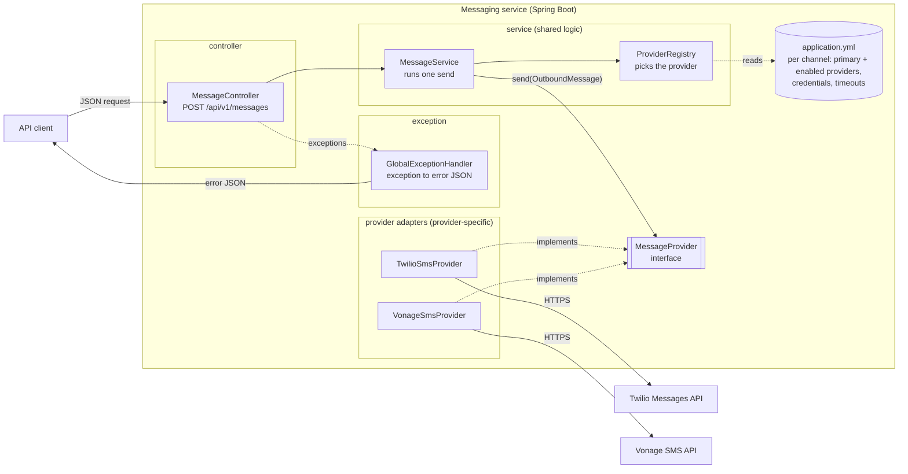
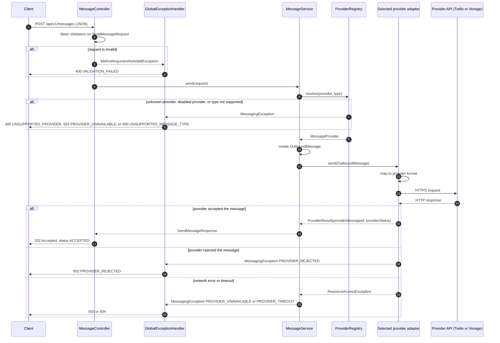
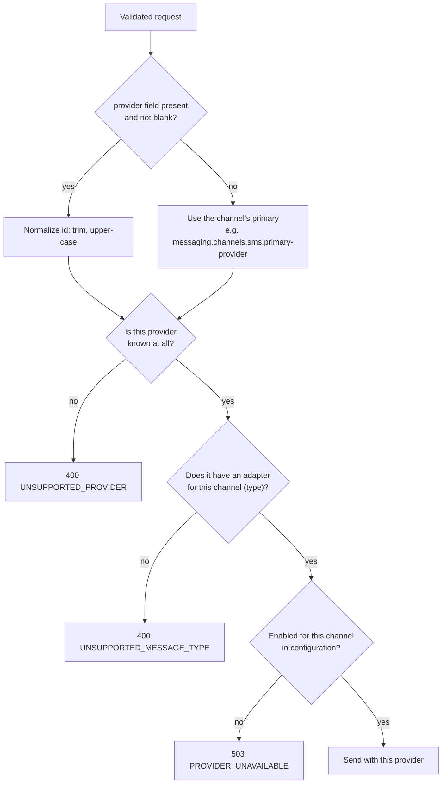
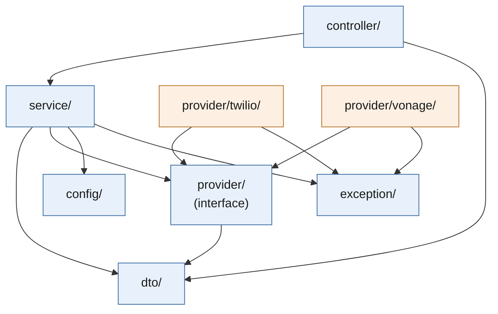
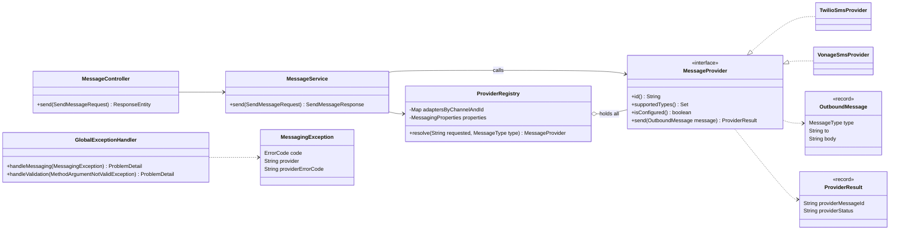
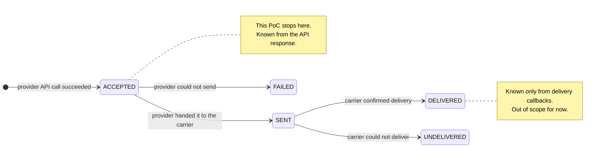
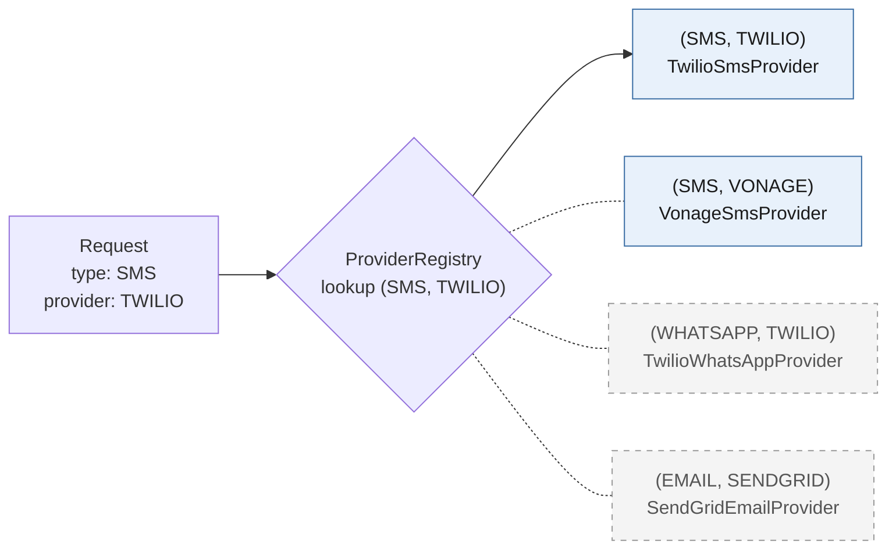

# Messaging Platform PoC: Design Document

| Item | Value |
|---|---|
| Status | Reviewed, ready for implementation |
| Date | 2026-10-14 |
| Scope | SMS through Twilio and Vonage, built so more providers and channels (WhatsApp, Email) can be added later |
| Stack | Java 21, Spring Boot 4.1.x (Spring MVC, Bean Validation, `RestClient`, Jackson 3) |

## Contents

0. [Summary and scope](#0-summary-and-scope)
1. [Architecture](#1-architecture)
2. [Request flow](#2-request-flow)
3. [Java structure](#3-java-structure)
4. [Shared and provider-specific responsibilities](#4-shared-and-provider-specific-responsibilities)
5. [API contract and examples](#5-api-contract-and-examples)
6. [Extensibility: adding a third provider](#6-extensibility-adding-a-third-provider)
7. [Future channels: WhatsApp and Email](#7-future-channels-whatsapp-and-email)
8. [Minimal implementation plan](#8-minimal-implementation-plan)
9. [Design decisions and trade-offs](#9-design-decisions-and-trade-offs)
10. [Out of scope (later)](#10-out-of-scope-later)
11. [Open questions for the reviewer](#11-open-questions-for-the-reviewer)

---

## 0. Summary and scope

We build one HTTP endpoint that accepts a provider-neutral message request and sends it through
a chosen SMS provider. The service has two halves:

- **The core** (shared, written once, everything outside `provider/twilio` and
  `provider/vonage`): validation, provider selection, calling the provider, building the
  response, and turning every failure into the same error format.
- **Provider adapters** (one per provider): each adapter knows only how to talk to its own
  provider's API. It turns our common message into the provider's request and turns the
  provider's reply into our common result.

The two halves meet at a single Java interface, `MessageProvider`. Adding a provider means
writing one adapter class, one small properties class, and a block of configuration. The
core does not change.

SMS is the only channel in this PoC. WhatsApp and Email are planned for later, so provider
selection and configuration are already organized **per channel**. See
[section 7](#7-future-channels-whatsapp-and-email).

### In scope

- `POST /api/v1/messages` for `type: SMS`
- Basic validation (required fields, phone number format, body length)
- Provider selection: explicit provider, otherwise a configurable primary provider
- Twilio and Vonage adapters
- Consistent success response and consistent error responses

### Out of scope for this PoC

Authentication, queues, retries, automatic fallback, delivery tracking (webhooks), a database,
rate limiting, templates, scheduling, and other channels (email, WhatsApp). See
[section 10](#10-out-of-scope-later).

---

## 1. Architecture



### Components and responsibilities

| Component | Responsibility | Knows about providers? |
|---|---|---|
| `MessageController` | Receives the HTTP request, triggers validation, calls the service, returns `202 Accepted` with the response body. | No |
| `GlobalExceptionHandler` | Converts every exception into one consistent error JSON with an HTTP status and an error `code`. | No |
| `MessageService` | Runs a single send: asks the registry for a provider, builds the `OutboundMessage`, calls the provider, translates network failures, returns the result. | Only through the interface |
| `ProviderRegistry` | Holds all provider adapters, keyed by channel and provider id. Applies the selection rules (explicit or the channel's primary, has an adapter for this channel, enabled). Checks each channel's primary provider at startup. | Only through the interface |
| `MessageProvider` | The contract every adapter implements. The only thing the core and the adapters share. | It is the boundary |
| `TwilioSmsProvider`, `VonageSmsProvider` | Translate our message into the provider's HTTP call and translate the reply (or error) back. | Yes, each knows only its own provider |
| `application.yml` | Per channel: primary provider and enabled providers. Per provider: credentials and sender ids. HTTP timeouts. | Values only |

**Dependency rule:** `controller` calls `service`. `service` talks to providers only through the
`MessageProvider` interface. Adapters depend on that interface and on the `exception` package.
Nothing outside `provider/twilio` and `provider/vonage` imports their classes. Spring wires the
adapters in. The folder layout is in [section 3](#3-java-structure).

---

## 2. Request flow

### 2.1 End-to-end sequence



### 2.2 Provider selection rules



Meaning of the words used:

- **Unsupported**: we have no adapter with that id (for example `"provider": "SINCH"`), or the
  provider has no adapter for the requested channel. This is a client mistake, so `400`.
- **Unavailable**: we have the adapter but cannot use it right now. Either it is switched off in
  configuration, or the provider's API could not be reached. This is our side or theirs, so `503`.
- **No fallback**: if the chosen provider fails, we return the error. We never silently try another
  provider in this PoC.

Configuration is checked once **at startup**. The application refuses to start, with a clear
message, if any of these is wrong:

- a channel that has adapters has no `messaging.channels.<channel>` block;
- the channel's `primary-provider` has no adapter for that channel, or is not in `enabled-providers`;
- an id in `enabled-providers` has no adapter for that channel (catches typos such as `TWILLIO`);
- an enabled provider is missing its credentials (its `isConfigured()` returns false).

So a request never fails because of bad configuration; it fails at deploy time instead.

### 2.3 The same flow in plain steps

1. **Receive**: the controller binds JSON to `SendMessageRequest`.
2. **Validate**: Bean Validation checks `type`, `to`, `body`. Failure returns `400` with the
   list of field errors.
3. **Select**: `ProviderRegistry.resolve()` applies the rules above.
4. **Prepare**: the service copies `type`, `to` and `body` into an `OutboundMessage`.
5. **Send**: the service calls `provider.send(message)`. The adapter maps fields, calls the
   provider API and reads the reply.
6. **Respond**: on success, `202 Accepted` with `status: ACCEPTED` and the provider's message id.
   On failure, one error JSON with a stable `code`.

---

## 3. Java structure

### 3.1 Project layout

A standard Spring Boot (Maven) project. Six folders under the base package, each with one
clear job. Replace `com.yourcompany` with your real domain.

```text
messaging-service/
├── pom.xml
├── README.md                                   how to run, curl examples
├── docs/
│   └── design.md                               this document
└── src/
    ├── main/
    │   ├── java/com/yourcompany/messaging/
    │   │   ├── MessagingApplication.java       Spring Boot entry point
    │   │   │
    │   │   ├── controller/
    │   │   │   └── MessageController.java      POST /api/v1/messages
    │   │   │
    │   │   ├── dto/
    │   │   │   ├── SendMessageRequest.java     incoming JSON + validation rules
    │   │   │   ├── SendMessageResponse.java    outgoing JSON on success
    │   │   │   └── MessageType.java            enum: SMS
    │   │   │
    │   │   ├── service/
    │   │   │   ├── MessageService.java         the send flow
    │   │   │   └── ProviderRegistry.java       picks the provider
    │   │   │
    │   │   ├── provider/
    │   │   │   ├── MessageProvider.java        interface every provider implements
    │   │   │   ├── OutboundMessage.java        what we give a provider
    │   │   │   ├── ProviderResult.java         what a provider gives back
    │   │   │   ├── twilio/
    │   │   │   │   ├── TwilioSmsProvider.java
    │   │   │   │   └── TwilioProperties.java
    │   │   │   └── vonage/
    │   │   │       ├── VonageSmsProvider.java
    │   │   │       └── VonageProperties.java
    │   │   │
    │   │   ├── exception/
    │   │   │   ├── ErrorCode.java              every error code + its HTTP status
    │   │   │   ├── MessagingException.java     the one exception we throw
    │   │   │   └── GlobalExceptionHandler.java turns exceptions into error JSON
    │   │   │
    │   │   └── config/
    │   │       └── MessagingProperties.java    per channel: primary + enabled providers
    │   │
    │   └── resources/
    │       └── application.yml                 all settings (secrets via env vars)
    │
    └── test/java/com/yourcompany/messaging/    same folders as main
        ├── controller/MessageControllerTest.java
        ├── service/ProviderRegistryTest.java
        ├── service/MessageServiceTest.java
        ├── provider/twilio/TwilioSmsProviderTest.java
        └── provider/vonage/VonageSmsProviderTest.java
```

**18 Java files** in `main`. Most are records or enums with a few lines each.

### 3.2 What goes in each folder

| Folder | Holds | Rule | Touched when adding a provider? |
|---|---|---|---|
| `controller/` | REST endpoints | Thin: receive, validate, call service, return. No business logic. | No |
| `dto/` | JSON request/response shapes | Plain records. No logic. | No |
| `service/` | The send flow and provider selection | Shared logic lives here. Never names a specific provider. | No |
| `provider/` | The `MessageProvider` interface and its two data records | The contract between `service/` and the providers. | No |
| `provider/<name>/` | One provider's adapter and its settings | Everything about that provider, and nothing else. | **Yes: add a new folder** |
| `exception/` | Error codes, the exception, the handler | All error handling in one place. | No |
| `config/` | Spring configuration and shared settings | No business logic. | No |

### 3.3 How the folders depend on each other

Arrows mean "uses". Nothing points into `twilio/` or `vonage/`; Spring finds them on its own.



Blue: shared, written once. Orange: provider-specific, one folder per provider.

### 3.4 Class diagram



### 3.5 Role of each class

| Folder | Class | Kind | Role |
|---|---|---|---|
| `controller` | `MessageController` | `@RestController` | Validates the request (`@Valid`), calls the service, returns `202`. |
| `dto` | `SendMessageRequest` | record | `type`, `provider` (optional), `to`, `body`, with validation annotations. |
| `dto` | `SendMessageResponse` | record | Success body returned to the client. |
| `dto` | `MessageType` | enum | `SMS`. Accepts any letter case (`sms`, `Sms`) through a small `@JsonCreator`. New channels are added here later. |
| `service` | `MessageService` | `@Service` | The send flow. The only place that calls a provider. |
| `service` | `ProviderRegistry` | `@Component` | Receives `List<MessageProvider>` from Spring, indexes them by channel and `id()`, applies the selection rules, fails startup on a duplicate (channel, id) pair or a bad primary. |
| `provider` | `MessageProvider` | interface | The extension point. Three methods, plus `isConfigured()` with a default. |
| `provider` | `OutboundMessage` | record | Provider-neutral message given to a provider. |
| `provider` | `ProviderResult` | record | Provider-neutral reply: provider's message id and its raw status. |
| `provider/twilio`, `provider/vonage` | `TwilioSmsProvider`, `VonageSmsProvider` | `@Component` | Translate our message to the provider's HTTP call and the reply (or error) back. |
| `provider/twilio`, `provider/vonage` | `TwilioProperties`, `VonageProperties` | `@ConfigurationProperties` | Credentials and sender id for one provider. |
| `exception` | `ErrorCode` | enum | Each error code with its HTTP status and title. One table for all errors. |
| `exception` | `MessagingException` | `RuntimeException` | The single exception the service and providers throw. Carries `ErrorCode`, provider id and optional provider error code. |
| `exception` | `GlobalExceptionHandler` | `@RestControllerAdvice` | Maps `MessagingException`, validation errors, unreadable JSON and unexpected errors to one error format. |
| `config` | `MessagingProperties` | `@ConfigurationProperties("messaging")` | Per channel: `primary-provider` and `enabled-providers`. |

### 3.6 Key code sketches

These sketches show shape and intent only. They are not the full implementation.

**The contract (`provider/MessageProvider.java`)**

```java
public interface MessageProvider {

    /**
     * Stable upper-case provider id used in requests and config, e.g. "TWILIO".
     * Two adapters may share an id if they serve different channels
     * (TwilioSmsProvider now, TwilioWhatsAppProvider later).
     */
    String id();

    /** Channels this adapter can send. For now always EnumSet.of(SMS). */
    Set<MessageType> supportedTypes();

    /** False when credentials are missing. Checked at startup for every enabled provider. */
    default boolean isConfigured() { return true; }

    /**
     * Sends one message.
     * Returns when the provider has ACCEPTED it (not when it is delivered).
     * Throws MessagingException(PROVIDER_REJECTED or PROVIDER_UNAVAILABLE)
     * when the provider answers with an error.
     */
    ProviderResult send(OutboundMessage message);
}
```

```java
public record OutboundMessage(MessageType type, String to, String body) {}

public record ProviderResult(String providerMessageId, String providerStatus) {}
```

**Request DTO with validation (`dto/SendMessageRequest.java`)**

```java
public record SendMessageRequest(
        @NotNull MessageType type,
        String provider,                                   // optional
        @NotBlank
        @Pattern(regexp = "^\\+[1-9]\\d{7,14}$",
                 message = "must be in E.164 format, for example +919876543210")
        String to,
        @NotBlank @Size(max = 1600) String body) {}
```

```java
public enum MessageType {
    SMS;

    @JsonCreator    // accept "sms", "Sms", ...; unknown values become 400 VALIDATION_FAILED
    public static MessageType from(String value) {
        return value == null ? null : valueOf(value.trim().toUpperCase(Locale.ROOT));
    }
}
```

**Selection (`service/ProviderRegistry.java`)**

```java
@Component
public class ProviderRegistry {

    // channel -> (provider id -> adapter), e.g. SMS -> { TWILIO: ..., VONAGE: ... }
    private final Map<MessageType, Map<String, MessageProvider>> adapters;
    private final Set<String> knownProviderIds;
    private final MessagingProperties properties;

    public ProviderRegistry(List<MessageProvider> providers, MessagingProperties properties) {
        // for each provider and each of its supportedTypes(): adapters[type][id] = provider
        // then fail startup (IllegalStateException) if:
        //  - a (type, id) pair is registered twice
        //  - a channel with adapters has no config block
        //  - a channel's primary has no adapter for it, or is not in enabled-providers
        //  - an id in enabled-providers has no adapter for that channel
        //  - an enabled provider returns isConfigured() == false
    }

    public MessageProvider resolve(String requested, MessageType type) {
        ChannelSettings channel = properties.channel(type);
        String id = (requested == null || requested.isBlank())
                ? channel.primaryProvider()
                : requested.trim().toUpperCase(Locale.ROOT);

        if (!knownProviderIds.contains(id))  throw new MessagingException(UNSUPPORTED_PROVIDER, id, ...);
        MessageProvider provider = adapters.getOrDefault(type, Map.of()).get(id);
        if (provider == null)                throw new MessagingException(UNSUPPORTED_MESSAGE_TYPE, id, ...);
        if (!channel.isEnabled(id))          throw new MessagingException(PROVIDER_UNAVAILABLE, id, ...);
        return provider;
    }
}
```

**The send flow (`service/MessageService.java`)**

```java
@Service
public class MessageService {

    private final ProviderRegistry registry;

    public SendMessageResponse send(SendMessageRequest request) {
        MessageProvider provider = registry.resolve(request.provider(), request.type());
        OutboundMessage message = new OutboundMessage(request.type(), request.to(), request.body());

        try {
            ProviderResult result = provider.send(message);
            // log: provider, providerMessageId, masked "to" (never the body)
            return SendMessageResponse.accepted(provider.id(), result);
        } catch (ResourceAccessException e) {
            // Network problem, shared for every adapter that uses RestClient:
            //  - could not connect (refused, DNS, connect timeout) => PROVIDER_UNAVAILABLE (not sent)
            //  - connected, but no reply in time (read timeout)     => PROVIDER_TIMEOUT (outcome unknown)
            throw MessagingException.fromNetworkFailure(provider.id(), e);
        }
    }
}
```

**An adapter (`provider/twilio/TwilioSmsProvider.java`)**

```java
@Component
class TwilioSmsProvider implements MessageProvider {

    private final RestClient client;
    private final TwilioProperties props;

    TwilioSmsProvider(RestClient.Builder builder, TwilioProperties props) {
        this.props = props;
        // Spring Boot gives each adapter its own builder, already set up with the shared timeouts
        this.client = builder.baseUrl("https://api.twilio.com/2010-04-01").build();
    }

    public String id() { return "TWILIO"; }

    public Set<MessageType> supportedTypes() { return EnumSet.of(MessageType.SMS); }

    public boolean isConfigured() {
        return hasText(props.accountSid()) && hasText(props.authToken()) && hasText(props.smsFrom());
    }

    public ProviderResult send(OutboundMessage message) {
        // 1. Form fields: To=message.to(), From=props.smsFrom(), Body=message.body()
        // 2. POST /Accounts/{AccountSid}/Messages.json  (form-urlencoded, Basic auth: SID + token)
        // 3. 2xx: read "sid" and "status" => new ProviderResult("SM...", "queued")
        // 4. 4xx: read Twilio "code" and "message" => MessagingException(PROVIDER_REJECTED)
        // 5. 5xx: MessagingException(PROVIDER_UNAVAILABLE)
    }
}
```

**Configuration (`config/MessagingProperties.java`)**

```java
@ConfigurationProperties("messaging")
public record MessagingProperties(Map<String, ChannelSettings> channels) {

    public record ChannelSettings(String primaryProvider, List<String> enabledProviders) {
        public boolean isEnabled(String id) { /* case-insensitive */ }
    }

    public ChannelSettings channel(MessageType type) { /* channels["sms"] for SMS */ }
}
```

The configuration has two clear parts:

- `messaging.channels.<channel>`: **routing**, read by `MessagingProperties` (core).
- `messaging.providers.<provider>`: **credentials and senders**, read by each adapter's own
  properties class (for example `TwilioProperties` with prefix `messaging.providers.twilio`).

One provider account can serve several channels (Twilio SMS and Twilio WhatsApp use the same
credentials), so credentials live under the provider and routing lives under the channel.

**Shared HTTP settings need no code.** Timeouts and the HTTP client come from Spring Boot's own
`spring.http.clients.*` properties (see [5.4](#54-primary-provider-configuration)), which apply to
every `RestClient.Builder`. The client is pinned to the JDK `HttpClient` so network errors always
look the same to `MessageService`.

---

## 4. Shared and provider-specific responsibilities

### 4.1 What is written once and reused

| Concern | Where | Notes |
|---|---|---|
| HTTP endpoint and JSON binding | `MessageController` | One endpoint for all providers. |
| Request validation | `SendMessageRequest` annotations | E.164 number, non-blank body up to 1600 chars, known `type`. Runs before any provider is chosen. |
| Provider selection | `ProviderRegistry` | Explicit or the channel's primary, has an adapter for the channel, enabled. |
| Configuration and credential checks | `ProviderRegistry` (startup) | Fail fast on bad config or missing credentials. |
| Network failure handling | `MessageService` | Could not connect: `PROVIDER_UNAVAILABLE`. Read timeout: `PROVIDER_TIMEOUT`. |
| HTTP timeouts and client | `spring.http.clients.*` in `application.yml` | One setting for all adapters, no code. |
| Response format | `SendMessageResponse` | Same shape whatever the provider. |
| Error format and HTTP status mapping | `ErrorCode`, `MessagingException`, `GlobalExceptionHandler` | One table, one exception class, one handler. |
| Logging | `MessageService` | One log line per send. Phone numbers masked, body never logged. |

### 4.2 What each provider implements separately

| Concern | Twilio | Vonage |
|---|---|---|
| Endpoint | `POST https://api.twilio.com/2010-04-01/Accounts/{AccountSid}/Messages.json` | `POST https://rest.nexmo.com/sms/json` |
| Authentication | HTTP Basic: Account SID + Auth Token | HTTP Basic: API key + API secret |
| Request format | Form fields `To`, `From`, `Body` | Form fields `from`, `to`, `text` (plus `type=unicode` when needed) |
| Number format | E.164 **with** `+` (`+91XXXXXXXXXX`) | E.164 **without** `+` (`91XXXXXXXXXX`), so the adapter strips it |
| Sender | `sms-from` (a Twilio number) | `sms-from` (number or alphanumeric sender id, depending on country) |
| Non-Latin text (Hindi, emoji) | Handled automatically | Must send `type=unicode`, so the adapter detects it |
| Success signal | HTTP `201`, body has `sid` and `status` (`queued`) | HTTP `200`, `messages[0].status == "0"`, id in `messages[0].message-id` |
| Failure signal | HTTP `4xx` with JSON `code` and `message` | **Still HTTP `200`**, `messages[0].status` is non-zero (for example `29`: demo account, number not whitelisted) |
| Mapping to our errors | `4xx` to `PROVIDER_REJECTED`, `5xx` to `PROVIDER_UNAVAILABLE` | status `1` (throttled) and `5` (internal error) to `PROVIDER_UNAVAILABLE`, any other non-zero status to `PROVIDER_REJECTED`, `5xx` to `PROVIDER_UNAVAILABLE` |
| Configuration | `account-sid`, `auth-token`, `sms-from` | `api-key`, `api-secret`, `sms-from` |

The Vonage row "failure signal" is the clearest reason this logic must live in the adapter:
a generic "2xx means success" rule would be wrong for Vonage.

> Checked against the Twilio and Vonage API reference pages on 2026-10-14. Provider APIs change,
> so glance at them again while writing each adapter.

### 4.3 What we deliberately do not share (yet)

Twilio and Vonage report errors in very different ways, so there is no common "HTTP error
translator" helper. If a third provider ends up repeating the same 4xx/5xx handling as
Twilio, extract a small helper at that point, not before.

---

## 5. API contract and examples

### 5.1 Endpoint

```
POST /api/v1/messages
Content-Type: application/json
```

| Field | Required | Rules |
|---|---|---|
| `type` | yes | `SMS` (only value for now). Any letter case is accepted. |
| `provider` | no | Case-insensitive provider id, for example `TWILIO` or `vonage`. Omit to use the channel's primary provider. |
| `to` | yes | E.164 format: `+`, country code, number. 8 to 15 digits. |
| `body` | yes | Not blank, at most 1600 characters. |

### 5.2 Request with an explicit provider

```json
{
  "type": "SMS",
  "provider": "TWILIO",
  "to": "+91XXXXXXXXXX",
  "body": "Welcome to our platform!"
}
```

Twilio is used, whatever the primary provider is.

### 5.3 Request without a provider

```json
{
  "type": "SMS",
  "to": "+91XXXXXXXXXX",
  "body": "Your verification code is 482913"
}
```

The primary provider configured for SMS is used.

### 5.4 Primary provider configuration

```yaml
spring:
  http:
    clients:                             # Spring Boot's shared HTTP client settings
      connect-timeout: 2s
      read-timeout: 10s
      imperative:
        factory: jdk                     # pin the JDK HttpClient: predictable network errors

messaging:
  channels:                              # routing, one block per channel
    sms:
      primary-provider: TWILIO           # used when the request has no "provider"
      enabled-providers: [TWILIO, VONAGE]

  providers:                             # credentials and senders, one block per provider
    twilio:
      account-sid: ${TWILIO_ACCOUNT_SID:}  # ":" = empty if the env var is not set
      auth-token: ${TWILIO_AUTH_TOKEN:}
      sms-from: "+15550001111"
    vonage:
      api-key: ${VONAGE_API_KEY:}
      api-secret: ${VONAGE_API_SECRET:}
      sms-from: "MyBrand"
```

- To switch the SMS primary to Vonage: set `channels.sms.primary-provider: VONAGE` (or the
  environment variable `MESSAGING_CHANNELS_SMS_PRIMARYPROVIDER=VONAGE`). No code change.
- To take a provider out of service for SMS: remove it from `enabled-providers`. Requests that
  name it get `503 PROVIDER_UNAVAILABLE`. If it is the primary, the app will not start until the
  primary is changed.
- Secrets come from environment variables, never from the committed file. A provider that is
  not in any `enabled-providers` list needs no credentials, so you can start with only Twilio's.

### 5.5 Success response

```http
HTTP/1.1 202 Accepted
Content-Type: application/json
```

```json
{
  "status": "ACCEPTED",
  "provider": "TWILIO",
  "providerMessageId": "SM2c7f9a1e0b3d4c5e6f7a8b9c0d1e2f3a",
  "providerStatus": "queued",
  "acceptedAt": "2026-10-14T10:15:30Z"
}
```

| Field | Meaning |
|---|---|
| `status` | Our normalized status. Always `ACCEPTED` in this PoC (see below). |
| `provider` | Which provider was actually used. Useful when the request omitted it. |
| `providerMessageId` | The provider's own id: the only message id in this PoC. Use it to find the message in the Twilio or Vonage console. |
| `providerStatus` | The provider's raw status, passed through for debugging. |
| `acceptedAt` | When the provider accepted it. |

### 5.6 Acceptance is not delivery

`202 Accepted` with `status: ACCEPTED` means only this:

> The provider received the message and agreed to try to send it.

It does **not** mean the phone received it. The SMS can still fail later (switched-off phone,
invalid number, carrier filtering, DND rules). The final result arrives minutes later through the
provider's delivery callbacks (Twilio status callbacks, Vonage delivery receipts), which this PoC
does not handle.



That is why the HTTP status is `202` and not `200` or `201`: the work is accepted, not finished.
The `status` field and `providerMessageId` are included now so delivery tracking can be added
later without changing the response shape.

### 5.7 Error responses

All errors use one shape: Spring's built-in RFC 9457 `ProblemDetail`
(`Content-Type: application/problem+json`) plus a stable `code` field that clients can switch on.

| `code` | HTTP | When |
|---|---|---|
| `VALIDATION_FAILED` | 400 | Missing or invalid field, unknown `type`, malformed JSON. |
| `UNSUPPORTED_PROVIDER` | 400 | No adapter with that id. |
| `UNSUPPORTED_MESSAGE_TYPE` | 400 | The provider has no adapter for this channel (`type`). |
| `PROVIDER_UNAVAILABLE` | 503 | Provider not enabled for the channel, could not connect, throttled, or returned `5xx`. |
| `PROVIDER_TIMEOUT` | 504 | Connected, but no reply in time. **The message may or may not have been sent.** |
| `PROVIDER_REJECTED` | 502 | Provider answered with an error (bad number, auth failure, trial limits). |
| `INTERNAL_ERROR` | 500 | Anything unexpected. Details are logged, not returned. |

**Validation failure**

```json
{
  "type": "about:blank",
  "title": "Validation failed",
  "status": 400,
  "detail": "The request has invalid fields.",
  "instance": "/api/v1/messages",
  "code": "VALIDATION_FAILED",
  "errors": [
    { "field": "to", "message": "must be in E.164 format, for example +919876543210" },
    { "field": "body", "message": "must not be blank" }
  ]
}
```

**Unsupported provider** (request had `"provider": "SINCH"`)

```json
{
  "type": "about:blank",
  "title": "Unsupported provider",
  "status": 400,
  "detail": "Provider 'SINCH' is not supported. Supported providers: TWILIO, VONAGE.",
  "instance": "/api/v1/messages",
  "code": "UNSUPPORTED_PROVIDER"
}
```

**Provider unavailable** (`VONAGE` is not in `channels.sms.enabled-providers`)

```json
{
  "type": "about:blank",
  "title": "Provider unavailable",
  "status": 503,
  "detail": "Provider 'VONAGE' is currently disabled for SMS.",
  "instance": "/api/v1/messages",
  "code": "PROVIDER_UNAVAILABLE",
  "provider": "VONAGE"
}
```

**Provider rejected the message** (Twilio error 21211, invalid "To" number)

```json
{
  "type": "about:blank",
  "title": "Provider rejected the message",
  "status": 502,
  "detail": "Twilio rejected the message: The 'To' number is not a valid phone number.",
  "instance": "/api/v1/messages",
  "code": "PROVIDER_REJECTED",
  "provider": "TWILIO",
  "providerErrorCode": "21211"
}
```

**Timeout**

```json
{
  "type": "about:blank",
  "title": "Provider timeout",
  "status": 504,
  "detail": "Twilio did not respond in time. The message may or may not have been sent; check before resending.",
  "instance": "/api/v1/messages",
  "code": "PROVIDER_TIMEOUT",
  "provider": "TWILIO"
}
```

Credentials, stack traces and full provider response bodies are never returned to the client.

---

## 6. Extensibility: adding a third provider

Example: add **Plivo**.

### 6.1 What changes

In the folder tree, the whole change is one new folder plus one config block:

```text
src/main/java/com/yourcompany/messaging/provider/
├── MessageProvider.java
├── OutboundMessage.java
├── ProviderResult.java
├── twilio/
├── vonage/
└── plivo/                          <-- NEW
    ├── PlivoSmsProvider.java       <-- NEW
    └── PlivoProperties.java        <-- NEW

src/main/resources/application.yml  <-- add a "plivo" block
src/test/java/.../provider/plivo/PlivoSmsProviderTest.java  <-- NEW
```

File by file:

| # | File | Change | Type |
|---|---|---|---|
| 1 | `provider/plivo/PlivoSmsProvider.java` | **New.** Implements `MessageProvider`: `id()` returns `"PLIVO"`, `supportedTypes()` returns `SMS`, `send()` maps to Plivo's API (`POST https://api.plivo.com/v1/Account/{auth_id}/Message/` with `src`, `dst`, `text`, Basic auth: auth id + auth token; reads `message_uuid[0]` from the `2xx` reply). Implements `isConfigured()`. Annotated `@Component`. | New code |
| 2 | `provider/plivo/PlivoProperties.java` | **New.** `@ConfigurationProperties("messaging.providers.plivo")` with `auth-id`, `auth-token`, `sms-from`. | New code |
| 3 | `application.yml` | **Add** a `plivo` block with its credentials, and add `PLIVO` to `channels.sms.enabled-providers`. | Config |
| 4 | `PlivoSmsProviderTest.java` | **New.** Adapter tests with a mocked HTTP server. | Tests |
| 5 | Main class, if needed | Register `PlivoProperties` (unnecessary if `@ConfigurationPropertiesScan` is used, which this design recommends). | None |

```yaml
messaging:
  channels:
    sms:
      enabled-providers: [TWILIO, VONAGE, PLIVO]   # PLIVO added
  providers:
    plivo:
      auth-id: ${PLIVO_AUTH_ID}
      auth-token: ${PLIVO_AUTH_TOKEN}
      sms-from: "+15550002222"
```

### 6.2 What does not change

`MessageController`, `SendMessageRequest`, `SendMessageResponse`, `GlobalExceptionHandler`,
`MessageService`, `ProviderRegistry`, `MessageProvider`, `ErrorCode`, `MessagingException`,
`MessagingProperties`, and both existing adapters.

### 6.3 Why it works

1. Spring finds `PlivoSmsProvider` because it is a `@Component` implementing `MessageProvider`.
2. `ProviderRegistry` receives it in its `List<MessageProvider>` and indexes it under
   `(SMS, "PLIVO")`.
3. `MessagingProperties` sees `PLIVO` in `channels.sms.enabled-providers`.
4. A request with `"provider": "PLIVO"` (or `"plivo"`) now resolves to it.
5. Setting `channels.sms.primary-provider: PLIVO` makes it the SMS default, again with no code change.

### 6.4 Design choice that makes this possible

Provider ids are **strings**, not a Java enum. With an enum (`enum Provider { TWILIO, VONAGE }`)
every new provider would also require editing a core file. With strings, the adapter declares its
own id and the registry rejects unknown ids at runtime with a clear `400`.

`MessageType` stays an enum, because adding a new channel (email, WhatsApp) is a real core change
anyway: new validation rules and new request fields. See
[section 7](#7-future-channels-whatsapp-and-email).

---

## 7. Future channels: WhatsApp and Email

SMS is the only channel built in this PoC. WhatsApp and Email are expected later, so the design
already makes room for them. This section says what is ready now, what a new channel will need,
and what we deliberately leave until then.

### 7.1 What is already channel-ready

| Part | Why it already works for more channels |
|---|---|
| Endpoint `POST /api/v1/messages` | Not tied to SMS. The same endpoint will send WhatsApp and Email. |
| `type` field in the request | This is the channel selector. Today only `SMS` is accepted. |
| Class and folder names | `MessageService`, `MessageProvider`, `SendMessageRequest`: nothing says "SMS" except the SMS adapters. |
| `ProviderRegistry` keyed by **channel + provider** | One provider can have a different adapter per channel (Twilio SMS and, later, Twilio WhatsApp) without an id clash. |
| Config per channel (`messaging.channels.sms`) | Each channel has its own primary provider and its own list of enabled providers. Email will not have Twilio as primary just because SMS does. |
| `UNSUPPORTED_MESSAGE_TYPE` error | Already returned when a provider has no adapter for the requested channel. |
| One folder per provider | Twilio's WhatsApp adapter goes next to its SMS adapter. An email-only provider gets its own folder. |
| Response shape and accepted vs delivered | Same meaning for every channel. Email providers also answer "accepted" first. |

### 7.2 Provider and channel map

Every adapter fills one cell. The registry looks up the cell for `(type, provider)`.

| Provider | SMS | WhatsApp | Email |
|---|---|---|---|
| Twilio | `TwilioSmsProvider` (**now**) | `TwilioWhatsAppProvider` (later) | |
| Vonage | `VonageSmsProvider` (**now**) | `VonageWhatsAppProvider` (later) | |
| SendGrid (example) | | | `SendGridEmailProvider` (later) |



Blue: built in this PoC. Grey dashed: future adapters, added without changing the core.

### 7.3 What adding a channel will change (example: Email)

| # | Change | Where | Notes |
|---|---|---|---|
| 1 | Add `EMAIL` to the enum | `dto/MessageType.java` | One line. |
| 2 | Add the new optional request field(s), e.g. `subject` | `dto/SendMessageRequest.java`, `provider/OutboundMessage.java` | Additive: existing SMS clients keep working. |
| 3 | Make validation depend on `type` | `dto/` (one small validator class) | Done once, when the second channel arrives. Replace the `@Pattern` on `to` with a class-level check: SMS and WhatsApp need an E.164 number; Email needs an email address and a `subject`. Body limits also differ per channel. |
| 4 | Add the adapter(s) | `provider/sendgrid/SendGridEmailProvider.java` + `SendGridProperties.java` | Same `MessageProvider` interface, `supportedTypes()` returns `EMAIL`. |
| 5 | Add the channel config | `application.yml` | A `messaging.channels.email` block plus the provider's credentials. |
| 6 | Tests | `src/test/...` | Adapter tests, validation tests for the new channel. |

**Not changed:** `MessageController`, `MessageService`, `ProviderRegistry`, `GlobalExceptionHandler`,
`ErrorCode`, `MessagingException`, `MessagingProperties`, and the SMS adapters.

Configuration with a second channel would look like this:

```yaml
messaging:
  channels:
    sms:
      primary-provider: TWILIO
      enabled-providers: [TWILIO, VONAGE]
    email:                                  # added with the Email channel
      primary-provider: SENDGRID
      enabled-providers: [SENDGRID]
  providers:
    twilio:  { account-sid: ..., auth-token: ..., sms-from: "+15550001111" }
    vonage:  { api-key: ...,     api-secret: ..., sms-from: "MyBrand" }
    sendgrid: { api-key: ...,    email-from: "no-reply@yourcompany.com" }
```

Folder tree after WhatsApp and Email (for illustration only):

```text
provider/
├── MessageProvider.java
├── OutboundMessage.java
├── ProviderResult.java
├── twilio/
│   ├── TwilioSmsProvider.java
│   ├── TwilioWhatsAppProvider.java     later
│   ├── TwilioApiClient.java            later: HTTP code shared by Twilio's two adapters
│   └── TwilioProperties.java
├── vonage/
│   ├── VonageSmsProvider.java
│   ├── VonageWhatsAppProvider.java     later
│   └── VonageProperties.java
└── sendgrid/                           later
    ├── SendGridEmailProvider.java
    └── SendGridProperties.java
```

### 7.4 Example requests later (not part of this PoC)

```json
{ "type": "WHATSAPP", "to": "+91XXXXXXXXXX", "body": "Your order has shipped." }
```

```json
{ "type": "EMAIL", "to": "user@example.com", "subject": "Welcome", "body": "Welcome to our platform!" }
```

Today both return `400 VALIDATION_FAILED` ("type must be one of [SMS]").

### 7.5 Channel facts to plan for

- **WhatsApp templates.** WhatsApp only allows free text inside a 24-hour window after the user
  last wrote to you. Outside it, you must send a pre-approved template. So the WhatsApp channel will
  need optional `template` and `templateParams` fields in the request.
- **Twilio WhatsApp** uses the same Messages API as Twilio SMS, with `whatsapp:` in front of the
  `To` and `From` numbers. When it is added, move the shared HTTP code into a small
  `TwilioApiClient` inside `provider/twilio/`. Keep that sharing inside the provider's folder, not in
  the core.
- **Vonage WhatsApp** uses Vonage's Messages API, not the SMS API used here. It will be a separate
  adapter class.
- **Email** needs `subject` and usually supports HTML and attachments. Start with plain text and a
  subject only.
- **If channels grow very different** (attachments, templates, rich media), the single flat request
  can later be split into one request shape per channel, chosen by `type`. That is a later decision;
  a flat request with a few optional fields is simpler while the differences are small.

### 7.6 What we deliberately do not add now

| Not added now | Why |
|---|---|
| `WHATSAPP` and `EMAIL` values in `MessageType` | No adapter could serve them. Adding them is a one-line change later. |
| `subject`, `template` fields | Unused by SMS. Adding optional fields later does not break clients. |
| Per-channel validator | With one channel, the `@Pattern` annotation is simpler. It is replaced in one place when the second channel arrives. |
| Separate request classes per channel | More classes and JSON type handling for no benefit while only SMS exists. |

The two things that **are** done now, because they would be awkward to change later, are the
registry key (channel + provider) and the per-channel configuration.

---

## 8. Minimal implementation plan

Each step ends with something that compiles and has tests passing.

| Step | Work | Done when |
|---|---|---|
| 1 | Create the project: Spring Boot 4.1.x, Java 21, Maven. Dependencies: `spring-boot-starter-webmvc`, `spring-boot-starter-validation`, `spring-boot-starter-restclient`, `spring-boot-configuration-processor`; for tests `spring-boot-starter-webmvc-test` and `spring-boot-starter-restclient-test`. Add `@ConfigurationPropertiesScan`. | App starts with an empty context. |
| 2 | Shared types: `dto/MessageType`, `exception/ErrorCode`, `exception/MessagingException`, `provider/MessageProvider`, `provider/OutboundMessage`, `provider/ProviderResult`. | Compiles. |
| 3 | `MessagingProperties` (per-channel routing) and `application.yml` with placeholders, including `spring.http.clients.*`. | Properties bind in a test. |
| 4 | `ProviderRegistry` keyed by (channel, provider id), with selection rules and startup checks. Unit tests using fake providers: explicit, primary, unknown provider, known provider without an adapter for the channel, disabled, case-insensitive id. Startup failures: bad primary, duplicate (channel, id), enabled id without an adapter, enabled provider without credentials, channel without config. | Tests pass. |
| 5 | `MessageService` including network failure mapping. Unit tests with a fake provider: success, rejection passes through. One small test with the real JDK client against a local port: refused connection maps to `PROVIDER_UNAVAILABLE`, a server that never answers maps to `PROVIDER_TIMEOUT`. This confirms how the client reports each case. | Tests pass. |
| 6 | API layer: `SendMessageRequest`, `SendMessageResponse`, `MessageController`, `GlobalExceptionHandler`. `MockMvc` tests for `202`, each validation error (including unknown `type`), lowercase `type`, and each error code's JSON shape. | Tests pass. |
| 7 | `TwilioSmsProvider` + `TwilioProperties`. Tests with `MockRestServiceServer`: request fields and auth header, success parsing, `4xx` to `PROVIDER_REJECTED`, `5xx` to `PROVIDER_UNAVAILABLE`. | Tests pass. |
| 8 | `VonageSmsProvider` + `VonageProperties`. Same tests, plus: `+` stripped from `to`, `type=unicode` for non-Latin text, HTTP `200` with non-zero status maps to `PROVIDER_REJECTED`. | Tests pass. |
| 9 | Manual smoke test with real or trial credentials (Twilio also offers test credentials that never send real SMS). A short README with the `curl` examples from section 5. | One real SMS sent through each provider, with and without `provider`. |

---

## 9. Design decisions and trade-offs

| Decision | Why | Trade-off |
|---|---|---|
| Six plain folders (`controller`, `dto`, `service`, `provider`, `exception`, `config`) | Names every Spring developer recognizes. Each provider is one sub-folder of `provider/`. | Not split by feature. Fine for one feature (sending messages); revisit if the service grows. |
| `MessageService` returns `SendMessageResponse` directly | One fewer class than a separate service-level result record. | The service knows the response DTO. Acceptable at this size. |
| One interface (`MessageProvider`), no abstract base class | Three methods are enough. A base class would hide logic and invite coupling. | Adapters repeat a few lines of `RestClient` setup. Acceptable. |
| Registry keyed by channel + provider id | Twilio SMS and Twilio WhatsApp can both be `TWILIO` later without a clash. | A slightly bigger lookup (a map of maps) than a single map. |
| Configuration split into `channels` (routing) and `providers` (credentials) | Each channel gets its own primary; one provider account serves several channels. | Two places to look in the YAML. |
| Provider ids as strings | New providers need no core change. | Typos are caught at runtime (`400`, or startup failure for the primary), not at compile time. |
| Spring Boot 4.1.x | 3.5 (the last 3.x line) left free support on 2026-06-30. 4.1 is supported until 2027-07-31. | Jackson 3 and renamed starters (`webmvc`, `restclient`); many online examples still show Boot 3. |
| Timeouts via `spring.http.clients.*`, JDK client pinned | No HTTP config class to write. Network errors always come from the same client. | None worth noting for a PoC. |
| Plain `RestClient` instead of provider SDKs | Same HTTP stack, timeouts and error handling for every adapter. Fewer dependencies. Twilio's SDK uses global static setup, which is awkward with two accounts or tests. | We read provider JSON ourselves. Switching an adapter to an SDK later only changes that adapter. |
| Vonage SMS API (not the newer Messages API) | Simpler auth (key and secret) and a simple request. | Moving to the Messages API later is an internal change to `VonageSmsProvider` only. |
| One exception type with an `ErrorCode` enum | One handler, one mapping table, no exception class tree. | The enum grows as codes are added. |
| `ProblemDetail` for errors | Built into Spring, standard format, no custom error class. | Clients see a few standard fields (`type`, `instance`) they may not need. |
| `202 Accepted` | Honest: the provider accepted, delivery is not confirmed. | Clients must not treat it as "delivered". |
| Startup checks of configuration and credentials | Bad config is found at deploy time, not on the first request. | The app will not start if the primary is disabled or an enabled provider has no credentials, which is intended. |
| Network failure mapping in the core | Written once for every `RestClient` adapter. | An adapter that uses an SDK must translate its own exceptions into `MessagingException`. |
| No database | Not needed to send. Keeps the PoC small. | No message history, status lookup or duplicate protection until a database is added. |
| No message id of our own | Without a database there is nowhere to keep it. The provider's id identifies successful sends. | Failed and timed-out attempts have no id; find them in the logs by time and masked number. |

---

## 10. Out of scope (later)

| Feature | How it would fit later |
|---|---|
| Authentication / API keys | Spring Security filter in front of the controller. No core change. |
| Automatic fallback | In `MessageService`: on `PROVIDER_UNAVAILABLE` (not on `PROVIDER_REJECTED` or `PROVIDER_TIMEOUT`), resolve the next provider from a configured list. The registry and adapters stay as they are. |
| Retries | Same place as fallback, with idempotency rules. Timeouts must not be retried blindly because the first attempt may have sent the SMS. |
| Database + our own message id | Save each send with our own `messageId` (UUID, created before calling the provider) next to `providerMessageId`. Return `messageId` in success and error responses (a new field, so existing clients keep working). |
| Delivery tracking | Needs the database above. Add one webhook endpoint per provider that maps the provider's status to `SENT`, `DELIVERED`, `UNDELIVERED`, `FAILED`. Add `GET /api/v1/messages/{id}`. |
| Queue / async sending | Controller enqueues, a worker calls `MessageService`. Response stays `202`. |
| Idempotency key | Optional `Idempotency-Key` header stored with the message to avoid duplicates on client retries. |
| Rate limiting, templates, scheduling, bulk send | Separate features on top of the same core. |
| Other channels (WhatsApp, email) | Planned. See [section 7](#7-future-channels-whatsapp-and-email). |
| India DLT rules | Indian commercial SMS needs registered sender ids and templates. Real traffic to `+91` numbers will need DLT details passed through the adapters. Not needed for a PoC on trial accounts. |

---

## 11. Open questions for the reviewer

None of these blocks implementation. The proposed default is used unless decided otherwise.

1. **Status for provider rejection:** `502` or `422` for rejections that are really the client's
   fault (well-formed but non-existent number)? **Default:** `502`. It is one line in `ErrorCode`
   to change.
2. **Sender id:** may the request choose a sender (`from`)? **Default:** no, the sender comes from
   configuration per provider.
3. **Vonage API:** SMS API or the newer Messages API from day one? **Default:** SMS API. Moving
   later only changes `VonageSmsProvider`.

Decided during review: Spring Boot 4.1.x (see [section 9](#9-design-decisions-and-trade-offs)).
