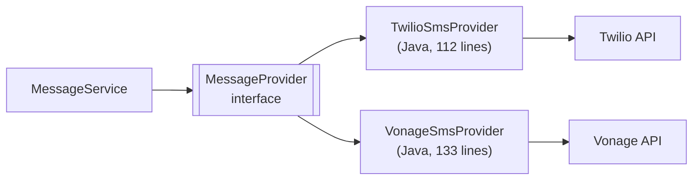
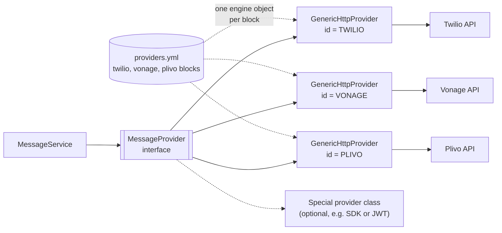
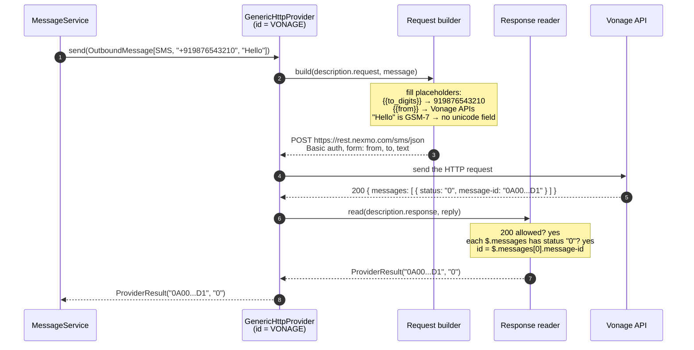
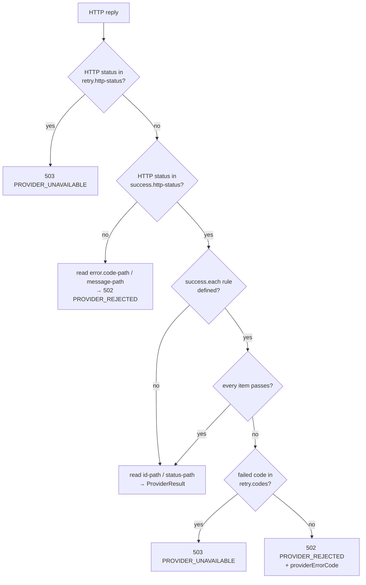
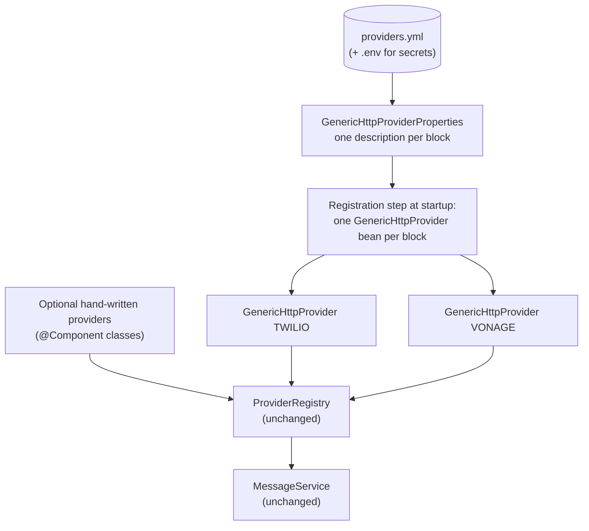

# Generic HTTP Provider ("Postman-style"): idea, design and plan

**Status:** proposal, nothing implemented yet.
**Idea from:** TL review after the demo.
**Goal:** add a new SMS provider by writing **configuration**, not a new Java class, the same way
Postman can call any REST API from a saved request.

Contents

1. [The idea in plain words](#1-the-idea-in-plain-words)
2. [The Postman comparison](#2-the-postman-comparison)
3. [Today vs. after](#3-today-vs-after)
4. [How a provider is described](#4-how-a-provider-is-described)
5. [Twilio as configuration](#5-twilio-as-configuration)
6. [Vonage as configuration](#6-vonage-as-configuration)
7. [A brand-new provider with zero Java](#7-a-brand-new-provider-with-zero-java)
8. [How one send works inside the engine](#8-how-one-send-works-inside-the-engine)
9. [How it plugs into the current code](#9-how-it-plugs-into-the-current-code)
10. [Safety: checks at startup](#10-safety-checks-at-startup)
11. [Decisions to agree with the TL first](#11-decisions-to-agree-with-the-tl-first)
12. [Implementation plan, step by step](#12-implementation-plan-step-by-step)
13. [Testing strategy](#13-testing-strategy)
14. [Risks and how we handle them](#14-risks-and-how-we-handle-them)
15. [What does not change](#15-what-does-not-change)
16. [Glossary](#16-glossary)

---

## 1. The idea in plain words

Today every provider has its own Java class (`TwilioSmsProvider`, `VonageSmsProvider`). Each class
knows how to build that provider's request and how to read its reply.

The TL's idea: **build one generic engine that can call any REST API**, and describe each provider
in a configuration file. The description says:

- **what to send:** URL, method, login, headers, body;
- **how to read the answer:** did it work, where is the message id, where is the error.

Adding a provider then means **adding a config block**. No new class, no new deployment of code
logic, just configuration.

---

## 2. The Postman comparison

In Postman you never write code to call an API. You fill in a form and save it:

```text
┌──────────────────────── Postman: saved request "Twilio SMS" ────────────────────────┐
│ POST   https://api.twilio.com/2010-04-01/Accounts/{{accountSid}}/Messages.json      │
│ Auth   Basic   {{apiKey}} / {{apiSecret}}                                           │
│ Body   x-www-form-urlencoded                                                        │
│          To    = {{to}}                                                             │
│          From  = {{from}}                                                           │
│          Body  = {{text}}                                                           │
└─────────────────────────────────────────────────────────────────────────────────────┘
          you press Send, then YOU read the reply and decide if it worked
```

Our engine works the same way, with one extra part. **Nobody reads the reply by eye**, so each
description also says how to understand the reply:

```text
┌──────────────────── Our engine: provider description "twilio" ──────────────────────┐
│ REQUEST  (same as Postman)                                                          │
│   POST, URL, Basic auth, form body with To / From / Body                            │
│                                                                                     │
│ RESPONSE (the extra part)                                                           │
│   success when   HTTP is 2xx                                                        │
│   message id at  $.sid                                                              │
│   status at      $.status                                                           │
│   error code at  $.code       error message at  $.message                           │
│   "try later" when HTTP is 429 or 5xx                                               │
└─────────────────────────────────────────────────────────────────────────────────────┘
          the engine sends it AND reads the reply by itself
```

| Postman | Our engine |
|---|---|
| Saved request | provider description in config |
| `{{variable}}` | `{{variable}}` placeholders, same idea |
| Environment (dev, prod values) | `.env` / environment variables for secrets |
| You read the reply | **response rules** read it automatically |
| Works for any REST API | works for any REST SMS API that fits the rules |

---

## 3. Today vs. after

**Today:** one Java class per provider.



**After:** one engine, many descriptions.



- `GenericHttpProvider` is **one Java class**. The app creates **one object of it per config
  block**, each with its own id and description.
- It **implements the same `MessageProvider` interface**, so the rest of the app sees no difference.
- A provider that cannot be described in config (vendor SDK, JWT signing, multi-step API) can still
  be a normal Java class. This is the **hybrid** model: config for the normal cases, code for the
  rare special cases.

---

## 4. How a provider is described

Each provider gets one block with three parts: **variables**, **request**, **response**.

```text
provider block
├── variables      secrets and settings (filled from .env)
├── request        what to send       → like Postman
│   ├── method, url
│   ├── auth       basic / bearer / header / none
│   └── body       form or json, with its fields
└── response       how to read the reply   → the part Postman doesn't have
    ├── success    when is it a success
    ├── id, status where to find them
    ├── error      where to find the error code and message
    └── retry      which errors mean "try later"
```

### 4.1 Placeholders available in templates

| Placeholder | Value | Example |
|---|---|---|
| `{{to}}` | phone number from the request, E.164 with `+` | `+919876543210` |
| `{{to_digits}}` | the same without `+` | `919876543210` |
| `{{text}}` | message body from the request | `Hello` |
| `` | any value from this block's `variables` | `{{api-key}}` → `abcd1234` |

### 4.2 The full list of settings (proposal)

| Setting | Meaning | Example |
|---|---|---|
| `id` | provider id used in requests | `TWILIO` |
| `channels` | channels it can send | `[SMS]` |
| `variables.*` | secrets and settings, usually `${ENV_VAR:}` | `api-key: ${VONAGE_API_KEY:}` |
| `request.method` | HTTP method | `POST` |
| `request.url` | URL, may contain placeholders | `https://rest.nexmo.com/sms/json` |
| `request.auth.type` | `basic`, `bearer`, `header` or `none` | `basic` |
| `request.auth.username` / `password` | for `basic` | `{{api-key}}` / `{{api-secret}}` |
| `request.auth.token` | for `bearer` | `{{token}}` |
| `request.auth.header-name` / `header-value` | for `header` | `X-API-KEY` / `{{key}}` |
| `request.body.format` | `form` or `json` | `form` |
| `request.body.fields.*` | body fields and their templates | `to: "{{to_digits}}"` |
| `request.body.unicode-fields.*` | extra fields added only when the text is not plain GSM-7 | `type: unicode` |
| `response.success.http-status` | HTTP statuses that may mean success | `2xx` or `200` |
| `response.success.each` / `field` / `equals` | extra check: every item in a list must have a field equal to a value | Vonage: each `$.messages[*]` has `status == "0"` |
| `response.id-path` | where the message id is | `$.sid` |
| `response.status-path` | where the provider status is (optional) | `$.status` |
| `response.error.code-path` / `message-path` | where error details are | `$.code` / `$.message` |
| `response.retry.http-status` | HTTP statuses that mean "try later" | `429, 5xx` |
| `response.retry.codes` | provider error codes that mean "try later" | Vonage: `1, 5` |

Paths like `$.sid` are **JSONPath**: a simple way to point into a JSON reply (`$` is the whole
reply, `.sid` is the `sid` field, `[0]` is the first item, `[*]` is every item).

---

## 5. Twilio as configuration

This block does exactly what `TwilioSmsProvider.java` does today.

```yaml
messaging:
  http-providers:
    twilio:
      id: TWILIO
      channels: [SMS]

      variables:
        account-sid: ${TWILIO_ACCOUNT_SID:}
        api-key:     ${TWILIO_API_KEY:}
        api-secret:  ${TWILIO_API_SECRET:}
        from:        ${TWILIO_SMS_FROM:}

      request:
        method: POST
        url: https://api.twilio.com/2010-04-01/Accounts/{{account-sid}}/Messages.json
        auth:
          type: basic
          username: "{{api-key}}"
          password: "{{api-secret}}"
        body:
          format: form
          fields:
            To:   "{{to}}"
            From: "{{from}}"
            Body: "{{text}}"

      response:
        success:
          http-status: 2xx
        id-path: $.sid
        status-path: $.status
        error:
          code-path: $.code
          message-path: $.message
        retry:
          http-status: [429, 5xx]
```

Line by line against today's Java:

| Today in `TwilioSmsProvider.java` | In the config |
|---|---|
| `BASE_URL` + `.uri("/Accounts/{accountSid}/Messages.json")` | `request.url` |
| `setBasicAuth(props.apiKey(), props.apiSecret())` | `request.auth` |
| `form.add("To", ...)`, `From`, `Body` | `request.body.fields` |
| `is2xxSuccessful()` → read `sid`, `status` | `response.success`, `id-path`, `status-path` |
| `readError` → `code`, `message` | `response.error` |
| `429` or `5xx` → `PROVIDER_UNAVAILABLE` | `response.retry.http-status` |
| `isConfigured()` checks 4 settings | engine checks that every `variables` value is filled |

---

## 6. Vonage as configuration

Vonage has quirks. Each one becomes one setting, and nothing is hidden:

```yaml
messaging:
  http-providers:
    vonage:
      id: VONAGE
      channels: [SMS]

      variables:
        api-key:    ${VONAGE_API_KEY:}
        api-secret: ${VONAGE_API_SECRET:}
        from:       ${VONAGE_SMS_FROM:}

      request:
        method: POST
        url: https://rest.nexmo.com/sms/json
        auth:
          type: basic
          username: "{{api-key}}"
          password: "{{api-secret}}"
        body:
          format: form
          fields:
            from: "{{from}}"
            to:   "{{to_digits}}"        # quirk 1: Vonage wants the number without "+"
            text: "{{text}}"
          unicode-fields:
            type: unicode                # quirk 2: added only for Hindi, emoji, ...

      response:
        success:
          http-status: 200
          each: $.messages               # quirk 3: HTTP 200 is not enough,
          field: status                  #          every part must have status "0"
          equals: "0"
        id-path: $.messages[0].message-id
        status-path: $.messages[0].status
        error:
          code-path: $.messages[?(@.status != "0")].status        # the first failed part
          message-path: $.messages[?(@.status != "0")].error-text
        retry:
          http-status: [429, 5xx]
          codes: ["1", "5"]              # quirk 4: throttled, internal error → try later
```

| Vonage quirk | Today (Java) | In the config |
|---|---|---|
| Number without `+` | `message.to().substring(1)` | `to: "{{to_digits}}"` |
| `type=unicode` for non-GSM text | `needsUnicode(...)` | `unicode-fields` |
| HTTP 200 can still be a failure | loop over `messages`, check `"0"` | `success.each` / `field` / `equals` |
| Codes 1 and 5 mean "try later" | `UNAVAILABLE_STATUSES` | `retry.codes` |

If both of these blocks work, the engine is general enough for most REST SMS providers: Twilio
and Vonage are quite different, and between them they cover most of the variations you will meet.

---

## 7. A brand-new provider with zero Java

Example: Plivo. Its API takes a **JSON** body instead of form fields. With the engine, that is just
`format: json`.

```yaml
messaging:
  http-providers:
    plivo:
      id: PLIVO
      channels: [SMS]
      variables:
        auth-id:    ${PLIVO_AUTH_ID:}
        auth-token: ${PLIVO_AUTH_TOKEN:}
        from:       ${PLIVO_SMS_FROM:}
      request:
        method: POST
        url: https://api.plivo.com/v1/Account/{{auth-id}}/Message/
        auth: { type: basic, username: "{{auth-id}}", password: "{{auth-token}}" }
        body:
          format: json
          fields:
            src:  "{{from}}"
            dst:  "{{to}}"
            text: "{{text}}"
      response:
        success: { http-status: 2xx }
        id-path: $.message_uuid[0]
        error:   { message-path: $.error }
        retry:   { http-status: [429, 5xx] }
```

Then enable it in the routing, exactly as today:

```properties
messaging.channels.sms.enabled-providers=TWILIO,VONAGE,PLIVO
```

And add `PLIVO_AUTH_ID`, `PLIVO_AUTH_TOKEN`, `PLIVO_SMS_FROM` to `.env`. **Done: no Java, no new class.**

> The Plivo URL, fields and reply format above are from memory, for illustration. Check Plivo's API
> docs when writing the real block.

---

## 8. How one send works inside the engine

Example: `"provider": "VONAGE"`, `to = "+919876543210"`, `text = "Hello"`.



The engine has three small parts:

| Part | Job | Input → output |
|---|---|---|
| **Template filler** | replaces `{{...}}` with real values | `"{{to_digits}}"` → `"919876543210"` |
| **Request builder** | turns the `request` description into an HTTP call | description + message → HTTP request |
| **Response reader** | applies the `response` rules | HTTP reply → `ProviderResult` or `MessagingException` |

How the response reader decides, for every provider:



These are exactly the rules Twilio and Vonage follow today, written once instead of per class.

---

## 9. How it plugs into the current code

The key point: **`GenericHttpProvider` implements `MessageProvider`.** The registry already accepts
"any list of `MessageProvider` objects", so the core needs no change.



### New files (proposal)

```text
src/main/java/com/example/messaging_service/provider/generic/
├── GenericHttpProvider.java             implements MessageProvider; one object per config block
├── GenericHttpProviderProperties.java   the description model (variables, request, response)
├── TemplateFiller.java                  {{placeholder}} → value
├── RequestBuilder.java                  description + message → HTTP request
├── ResponseReader.java                  HTTP reply → ProviderResult / MessagingException
├── GsmCharset.java                      "is this text plain GSM-7?" (moved from the Vonage adapter)
└── GenericHttpProviderRegistration.java creates one bean per config block at startup

src/main/resources/providers.yml         twilio, vonage blocks (imported by application.properties)
```

### Removed at the end (after parity is proven, see step 7 and 8 of the plan)

```text
provider/twilio/TwilioSmsProvider.java, TwilioProperties.java
provider/vonage/VonageSmsProvider.java, VonageProperties.java
```

### Unchanged

Controller, service, registry, error handling, DTOs, `MessageProvider`, routing settings
(`messaging.channels.*`). See [section 15](#15-what-does-not-change).

---

## 10. Safety: checks at startup

Config mistakes can't be caught by the compiler, so the engine checks every description **when the
app starts**, in the same spirit as today's `ProviderRegistry` checks. The app refuses to start
with a clear message if:

| Check | Example mistake | Message (proposal) |
|---|---|---|
| Required parts present | no `request.url` | `http-providers.plivo: request.url is missing` |
| Valid choices | `auth.type: basik` | `http-providers.plivo: auth.type must be basic, bearer, header or none` |
| Placeholders exist | `{{api_key}}` but the variable is `api-key` | `http-providers.vonage: unknown placeholder {{api_key}} in request.auth.username` |
| Variables filled (for enabled providers) | `VONAGE_API_SECRET` not set | `VONAGE is enabled for SMS but its credentials are missing` (as today) |
| Paths are valid JSONPath | `id-path: $.messages[0` | `http-providers.vonage: response.id-path is not valid JSONPath` |
| Ids unique and upper case | two blocks with `id: TWILIO` | `Two adapters for (SMS, TWILIO)` (as today) |
| Form body is flat | nested fields with `format: form` | `http-providers.x: form bodies cannot have nested fields` |

Goal, same as today: **a bad config fails the deploy, never a customer's request.**

---

## 11. Decisions to agree with the TL first

| # | Question | Options | Recommendation |
|---|---|---|---|
| 1 | Hybrid or config-only? | (a) config for most, Java class still allowed for special providers; (b) config only | **(a) hybrid.** Keeps the door open for SDK/JWT providers at no extra cost, because the interface stays. |
| 2 | Where do descriptions live? | (a) `providers.yml` imported from `application.properties`; (b) inside `application.properties`; (c) a database | **(a) YAML file.** Nested blocks are far easier to read in YAML. A database (reload without restart) is a later step. |
| 3 | How to point into replies? | (a) JSONPath (`$.messages[0].message-id`); (b) Jackson JSON Pointer (`/messages/0/message-id`) | **(a) JSONPath.** It supports "every item" (`[*]`) and filters, which Vonage needs, and it looks like what people know from Postman tests. Adds one library (`com.jayway.jsonpath:json-path`, version managed by Spring Boot). |
| 4 | How to build JSON bodies? | (a) fields map, turned into JSON by Jackson; (b) a raw JSON text template | **(a) fields map.** Jackson handles quotes and escaping, so a `"` in a message can't break the JSON. |
| 5 | Which auth types in version 1? | basic, bearer, custom header, none, (later: OAuth, JWT) | **basic, bearer, header, none.** OAuth/JWT providers use the hybrid escape hatch. |
| 6 | Unicode handling | (a) built-in GSM-7 check + `unicode-fields`; (b) not supported | **(a).** Vonage needs it today. |
| 7 | Migrate Twilio and Vonage too, or only new providers? | (a) migrate both, delete old classes; (b) keep old classes, use engine for new ones only | **(a)**, but only after parity tests pass, so there is one way of doing things. |

---

## 12. Implementation plan, step by step

Same working style as the first build: **one step at a time, each step ends with tests passing,
reviewed, then committed.**

| Step | Work | Done when |
|---|---|---|
| **0. Agree** | Go through [section 11](#11-decisions-to-agree-with-the-tl-first) with the TL. Freeze the config format (sections 4 to 6). | Decisions written down. |
| **1. Config model** | `GenericHttpProviderProperties`: records for `variables`, `request`, `response`. `providers.yml` with the Twilio and Vonage blocks, imported from `application.properties`. | A binding test loads both blocks into the records with every field correct. |
| **2. Template filler** | Replace `{{to}}`, `{{to_digits}}`, `{{text}}` and ``. Error on unknown placeholders. Move the GSM-7 check into `GsmCharset`. | Unit tests: each placeholder, unknown placeholder, GSM vs Hindi vs emoji. |
| **3. Request builder** | Build method, URL, auth (basic, bearer, header, none), body (form or JSON), `unicode-fields`. | `MockRestServiceServer` tests: exact URL, auth header, form body, JSON body, unicode field added only when needed. |
| **4. Response reader** | Apply success, `each` rule, id and status paths, error paths, retry statuses and retry codes. Map to `ProviderResult` or `MessagingException` with the same error codes as today. | Unit tests with real-shaped Twilio and Vonage replies: success, 4xx, 429, 5xx, Vonage 200 with status 29, status 1, multi-part with one failed part. |
| **5. `GenericHttpProvider`** | Implements `MessageProvider`: `id()`, `supportedTypes()`, `isConfigured()` (all variables filled), `send()` (builder → HTTP → reader). | Tests pass using the Twilio description against a mock server. |
| **6. Registration + startup checks** | Create one `GenericHttpProvider` bean per block at startup. Add the checks from [section 10](#10-safety-checks-at-startup). | Context test starts with both blocks; one test per startup failure. |
| **7. Twilio parity, then switch** | Run **every expectation of today's `TwilioSmsProviderTest`** against the generic Twilio block. When identical: remove `TwilioSmsProvider` and `TwilioProperties`. Real SMS smoke test. | Parity tests pass; real SMS via Twilio works; old classes deleted. |
| **8. Vonage parity, then switch** | Same for `VonageSmsProviderTest`: `+` stripping, unicode, 200-with-status, multi-part, retry codes. Remove `VonageSmsProvider` and `VonageProperties`. Real SMS smoke test. | Parity tests pass; real SMS via Vonage works; old classes deleted. |
| **9. Docs** | "How to add a provider with config only" guide; update README, `demo.md`, `.env.example`. | A teammate can add a provider by following the guide. |
| **10. Prove it** | Add a third provider (or a fake one in tests) using **only config**. | It sends with no Java change. |

Order matters: the engine is fully built and tested (steps 1 to 6) **before** anything existing is
touched. Old adapters are removed only after the new ones are proven identical (steps 7 and 8).

---

## 13. Testing strategy

**Parity first.** Today's adapter tests already describe exactly how Twilio and Vonage must behave:
URL, headers, form fields, reply handling, every error case. They become the acceptance tests for
the engine:

```text
TwilioSmsProviderTest expectations  ──►  run against GenericHttpProvider(twilio block)  ──►  must all pass
VonageSmsProviderTest expectations  ──►  run against GenericHttpProvider(vonage block)  ──►  must all pass
```

If they all pass, the generic engine behaves **exactly** like the hand-written adapters, and those
can be deleted safely.

| Test | What it proves |
|---|---|
| Binding test | `providers.yml` loads correctly |
| Template filler tests | placeholders, GSM-7 detection |
| Request builder tests | the HTTP request on the wire is exactly right |
| Response reader tests | every reply shape maps to the right result or error code |
| Parity tests (Twilio, Vonage) | the engine matches today's behaviour exactly |
| Startup check tests | every config mistake stops the app with a clear message |
| Existing controller, service, registry tests | **unchanged and still passing** |
| Real smoke test | real SMS through both providers |

---

## 14. Risks and how we handle them

| Risk | Why it matters | How we handle it |
|---|---|---|
| The config "language" keeps growing | every odd provider wants a new switch; config becomes code | Hybrid model: if a provider needs more than the agreed settings, write a Java class instead of adding switches |
| Mistakes found late | no compiler for YAML | Strict startup checks (section 10); parity tests |
| Harder debugging | logic is in config, not code | Debug log of the built request (URL, fields; **never** secrets) and of which rule decided the result |
| Secrets leaking | templates contain credentials | Secrets only via `${ENV_VAR}`; auth values never logged; startup errors name the setting, never its value |
| Broken JSON from user text | a `"` in a message | JSON bodies built from a fields map by Jackson, never by string concatenation |
| Behaviour drift during migration | Twilio/Vonage work today | Old adapters stay until parity tests pass; real smoke test before deleting |

---

## 15. What does not change

```text
┌───────────────────────────────────────────────────────────────┐
│  UNCHANGED                                                    │
│  MessageController       POST /api/v1/messages                │
│  MessageService          send flow, network errors, logging   │
│  ProviderRegistry        selection rules, startup checks      │
│  GlobalExceptionHandler  error JSON                           │
│  ErrorCode, MessagingException, DTOs                          │
│  MessageProvider         the interface                        │
│  messaging.channels.*    routing (primary, enabled)           │
│  API contract            same request, same 202, same errors  │
└───────────────────────────────────────────────────────────────┘
```

**For API clients, nothing changes at all**: same endpoint, same request, same responses, same
error codes. The change is entirely behind the `MessageProvider` interface, which is why the
original design made it the only boundary between the core and the providers.

---

## 16. Glossary

| Word | Meaning |
|---|---|
| **Generic HTTP provider / engine** | One Java class that can call any REST SMS API from a description. |
| **Provider description / block** | The config that tells the engine how to call one provider and read its replies. |
| **Placeholder** | `{{name}}` in a template, replaced by a real value when sending. |
| **JSONPath** | A short way to point into JSON: `$.messages[0].message-id`. |
| **Parity test** | A test proving the new engine behaves exactly like the old class. |
| **Hybrid model** | Config for normal providers, a Java class allowed for special ones. |
| **GSM-7** | The basic SMS alphabet; anything outside it needs Unicode mode. |
| **Startup check** | Validation that stops the app at deploy time if config is wrong. |
