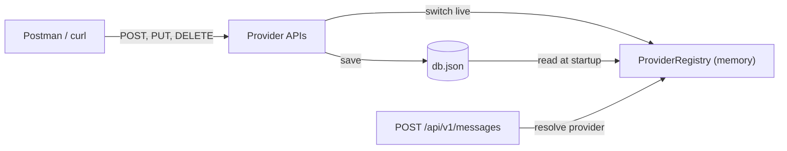
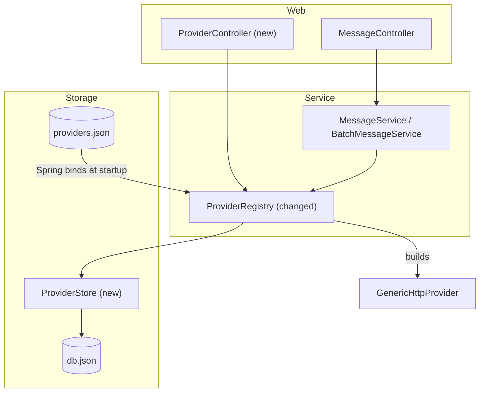
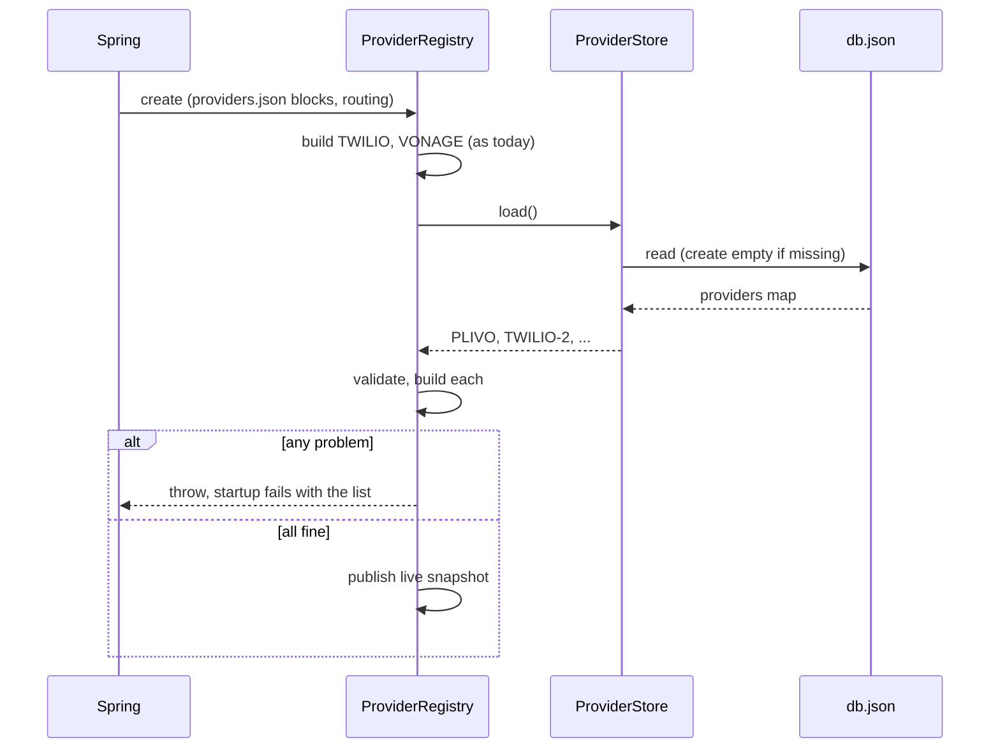
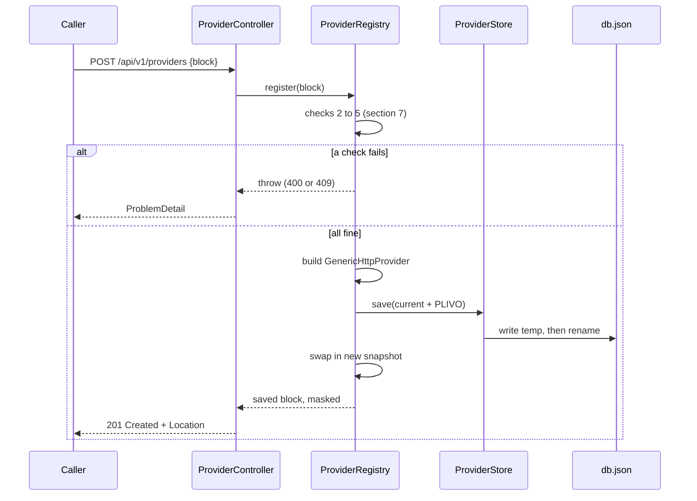
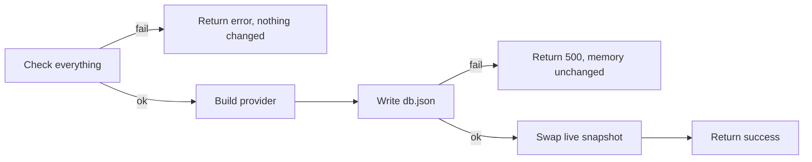

# Provider Management APIs: Plan

| Item | Value |
|---|---|
| Branch | `feat/provider` |
| Status | Approved and implemented. Decisions recorded in section 14. |
| Requirement | APIs to register, update and unregister providers, stored in a local `db.json` file that survives restarts |

## Contents

1. [The requirement in plain words](#1-the-requirement-in-plain-words)
2. [Where we start today](#2-where-we-start-today)
3. [Scope](#3-scope)
4. [Design decisions (options and recommendation)](#4-design-decisions-options-and-recommendation)
5. [The db.json file](#5-the-dbjson-file)
6. [API contract](#6-api-contract)
7. [Validation rules](#7-validation-rules)
8. [How it works inside](#8-how-it-works-inside)
9. [Safety: live changes, file writes, failures](#9-safety-live-changes-file-writes-failures)
10. [Code changes, file by file](#10-code-changes-file-by-file)
11. [Test plan](#11-test-plan)
12. [Implementation steps](#12-implementation-steps)
13. [Risks and limits](#13-risks-and-limits)
14. [Decisions](#14-decisions)

---

## 1. The requirement in plain words

Today, adding a provider (for example Plivo, or a second Twilio account) means editing
`providers.json` inside the project and restarting the app. The team lead wants this done
through the API instead:

| Operation | What the caller does | What the app does |
|---|---|---|
| Register | Sends the provider's settings | Checks them, saves them to `db.json`, and makes the provider usable right away |
| Update | Sends new settings for an existing provider | Checks them, replaces the saved copy, and switches to the new settings right away |
| Unregister | Names a provider | Removes it from `db.json` and stops using it right away |

"Survives restarts" means: when the app starts, it reads `db.json` and loads every provider in
it again. Nothing registered through the API is lost.



---

## 2. Where we start today

What exists on `feat/provider` right now:

| Piece | What it does today |
|---|---|
| `providers.json` | Holds routing (`channels.sms.primary-provider`, `enabled-providers`) and one block per provider (Twilio, Vonage) |
| `GenericHttpProvidersProperties` | Spring binds `providers.json` into Java records: `Description`, `Request`, `Auth`, `Body`, `Response` |
| `GenericHttpProvider` | Built from one `Description`. Sends the SMS using the block's URL, auth, body and response paths. Its constructor runs `DescriptionValidator` and throws when the block is broken |
| `ProviderRegistry` | Built **once at startup**. Creates one `GenericHttpProvider` per block, checks routing, and answers `resolve(provider, type)` for every send |
| `MessageService`, `BatchMessageService` | Call `registry.resolve(...)` and then `provider.send(...)` |

What is missing for this feature:

1. The registry cannot change after startup. Its maps are filled in the constructor and never
   touched again.
2. Nothing reads or writes a JSON file other than `providers.json` (read once by Spring).
3. No controller for providers, and no error codes like "not found" or "already exists".
4. The records in `GenericHttpProvidersProperties` are only read by Spring's binder. Jackson does
   not yet know how to read or write them as JSON in the `providers.json` style (`display-name`,
   `"basic"`, `"form"`).

The good news: the hard part (a provider described fully by one JSON block, plus the validator)
already exists. This feature adds a way to store those blocks and swap them in while the app runs.

---

## 3. Scope

**In scope**

- `POST /api/v1/providers`: register
- `PUT /api/v1/providers/{id}`: update
- `DELETE /api/v1/providers/{id}`: unregister
- `GET /api/v1/providers` and `GET /api/v1/providers/{id}`: read back (masked). Not in the
  requirement, but needed to check what was saved. Lists **all** providers, from both files,
  with `source` and `read-only`.
- `db.json` storage: created if missing, read at startup, written on every change
- Changes take effect without a restart
- Tests and README section

**Not in scope (later)**

- Authentication on these APIs (see [Risks](#13-risks-and-limits))
- A real database
- Running more than one instance of the app (each would have its own `db.json`)
- Changing routing (`primary-provider`) through the API
- Hand-written Java providers (SDK, JWT): only config-driven providers can be registered

---

## 4. Design decisions (options and recommendation)

Each decision lists the options and the one I recommend. The ones that need your answer are
recorded in [Decisions](#14-decisions).

### D1. What happens to Twilio and Vonage?

| Option | What it means | Good | Bad |
|---|---|---|---|
| **A. Keep them in `providers.json`, read-only** | `db.json` holds only providers added through the API. Twilio and Vonage cannot be updated or deleted through the API | Smallest change. Nothing that works today can break. Their secrets stay in `.env` | Two places hold providers |
| B. Move everything into `db.json` | `providers.json` keeps only routing. All provider blocks live in `db.json` | One source of truth | Twilio and Vonage could be deleted by one wrong call. Bigger change. Secrets for them end up in a file |
| C. Copy them into `db.json` on first start | First start seeds `db.json` from `providers.json`, then `db.json` wins | One place after the first start | Confusing: editing `providers.json` later does nothing |

**Recommendation: A.** Start safe. We can move to B later once the API has auth.

### D2. What does the request body look like?

| Option | Example | Good | Bad |
|---|---|---|---|
| **A. The same block as in `providers.json`, plus `enabled`** | `{ "id": "PLIVO", "request": { "url": ... }, "response": { ... } }` | No new format to learn or map. The existing validator checks it. Works for any provider shape (auth-id, api-key, header token) | The body is long |
| B. A short "credentials" form | `{ "type": "plivo", "credentials": { "auth-id": ..., "auth-token": ... } }` | Short | The app must already know every provider type in code. A new provider needs new code, which defeats the point |

**Recommendation: A.** The whole point of the generic provider is that one block describes any
provider. A short form only works for providers we hard-code.

### D3. How are secrets (auth tokens, API keys) sent and kept?

| Option | What the caller sends | Good | Bad |
|---|---|---|---|
| **A. Raw values only** | `"auth-token": "abc123"` | Easy from Postman. No manual step, no restart | Secret sits in `db.json` |
| B. Placeholders only | `"auth-token": "${PLIVO_AUTH_TOKEN:}"` | Secret stays in `.env` or env vars | Needs a manual `.env` edit and a restart, which defeats "no restart" |
| C. Both allowed | Either of the above | Caller chooses | More code and two behaviours to explain |

**Decided: A, raw values only**, with these rules:

- A value containing `${` is rejected with 400, so nobody saves a placeholder thinking it will be
  resolved.
- `db.json` is git-ignored, like `.env`.
- Responses never show a secret: every filled variable comes back as `"****"`.
- On update, sending `"****"` for a variable means "keep what is stored", so the caller does not
  have to send secrets again just to change the URL.
- Production later: a secret manager (Azure Key Vault, AWS Secrets Manager) or encrypted storage.

### D4. How does a registered provider become usable for sending?

Today a provider can send only when it is in `channels.sms.enabled-providers` in `providers.json`.

| Option | What it means | Good | Bad |
|---|---|---|---|
| **A. An `enabled` field on the provider** | `"enabled": true` in the body. The registry treats it as enabled for its channels | Self-contained: one call registers and turns it on. Can be registered as `false` first and switched on later | Two ways to enable (routing list for Twilio and Vonage, flag for API providers) |
| B. Also edit routing through the API | A separate endpoint changes `enabled-providers` | One way to enable | `providers.json` is on the classpath and cannot be written. Would need routing in `db.json` too |

**Recommendation: A.** Missing `enabled` means `false`, so nothing sends by accident.
Rule: an enabled provider must have every variable filled (same rule as Twilio and Vonage today).

### D5. Update: full replace or partial change?

| Option | Good | Bad |
|---|---|---|
| **A. `PUT`, full replace** | Simple. What you send is what is stored. The validator checks the full block | Caller sends the whole block again |
| B. `PATCH`, partial merge | Short calls | Merge rules for nested maps are hard to get right and to explain |

**Recommendation: A**, with the `"****"` rule from D3 so secrets do not have to be resent.

### D6. Unregister: delete or disable?

| Option | Good | Bad |
|---|---|---|
| **A. Hard delete from `db.json`** | Matches the word "unregister". The id can be reused | Gone for good (no undo) |
| B. Soft delete (mark as removed) | Undo possible | Clutters the file, and "disable" already exists through `enabled: false` |

**Recommendation: A.** To pause a provider without losing it, update it with `enabled: false`.
Guard: a provider that is a channel's `primary-provider` cannot be deleted (409).

### D7. When do changes take effect?

| Option | Good | Bad |
|---|---|---|
| **A. Right away, in memory** | Matches the requirement ("register and use") | Registry must become changeable while requests run (see section 9) |
| B. Only after a restart | Very simple | Not useful: why have an API then |

**Recommendation: A.**

### D8. What if `db.json` has a broken entry at startup?

This can only happen if someone edits the file by hand, because the API checks every block
before saving.

| Option | Good | Bad |
|---|---|---|
| **A. Fail startup with a clear message** | Same as `providers.json` today. Never runs half-configured | One bad hand edit stops the app |
| B. Skip the broken provider and log an error | App still starts | Easy to miss the log; a provider silently disappears |

**Recommendation: A**, to stay consistent with how `providers.json` is treated.

### D9. Where does `db.json` live?

| Option | Good | Bad |
|---|---|---|
| **A. Next to the app, path in config** | `messaging.db-file=./db.json`, change it with an env var on a server | Must point at a folder that survives redeploys on the server |
| B. Inside `src/main/resources` | None | The classpath is read-only inside a jar. Cannot be written |

**Recommendation: A.**

---

## 5. The db.json file

### Shape

One top-level key per collection, so the file can hold other things later (the name `db.json` is
generic). Each provider is stored under its id in lower case, in the exact `providers.json`
block format plus `enabled`.

```json
{
  "providers": {
    "plivo": {
      "id": "PLIVO",
      "display-name": "Plivo",
      "channels": ["SMS"],
      "enabled": true,
      "variables": {
        "auth-id": "<your-plivo-auth-id>",
        "auth-token": "<your-plivo-auth-token>",
        "from": "<your-plivo-number>"
      },
      "request": { "...": "same as the register body" },
      "response": { "...": "same as the register body" }
    }
  }
}
```

### Lifecycle

| Moment | What happens to the file |
|---|---|
| First start, file missing | Created as `{ "providers": {} }` |
| Start, file present | Read. Every provider is built and checked (D8) |
| Start, file is not valid JSON | Startup fails with the file name and the error. The file is **not** overwritten |
| Register / update / unregister | The whole file is rewritten safely (section 9) |
| Hand edit while the app runs | Not picked up until restart, and the next API change overwrites it. Do not edit by hand while running |

### Git

`db.json` and its temp file `db.json.tmp` are added to `.gitignore`, because they may hold secrets.

---

## 6. API contract

Base path: `/api/v1/providers`. All errors use the existing ProblemDetail format with a `code`.

| Method and path | Purpose | Success |
|---|---|---|
| `POST /api/v1/providers` | Register | `201 Created`, `Location: /api/v1/providers/PLIVO`, body = saved provider (masked) |
| `PUT /api/v1/providers/{id}` | Update | `200 OK`, body = saved provider (masked) |
| `DELETE /api/v1/providers/{id}` | Unregister | `204 No Content` |
| `GET /api/v1/providers` | List every provider (providers.json and db.json) with `source` and `read-only` | `200 OK`, list (masked) |
| `GET /api/v1/providers/{id}` | One provider, from either file | `200 OK` (masked) |

### Request body fields

| Field | Required | Notes |
|---|---|---|
| `id` | Yes on POST. On PUT, optional; if sent it must match the path | Upper-cased. Letters, digits, `_`, `-`. Example `PLIVO`, `TWILIO-2` |
| `display-name` | No | Shown in error messages. Defaults to the id |
| `channels` | Yes | Today only `["SMS"]` |
| `enabled` | No, defaults to `false` | `true` makes it usable for sending right away |
| `variables` | No, but every provider in practice has some | Secrets and settings used as `{{name}}`. Real values only; `${...}` is rejected |
| `request.method` | Yes | `POST`, `PUT` or `PATCH` |
| `request.url` | Yes | `https://...`. May use variables, never `{{to}}` or `{{text}}` |
| `request.auth.type` | Yes | `basic`, `bearer`, `header` or `none`, plus its fields |
| `request.body.format` | Yes | `form` or `json` |
| `request.body.fields` | Yes | Field name to template, e.g. `"dst": "{{to_digits}}"` |
| `request.body.unicode-fields` | No | Extra fields added for non-GSM text |
| `response.id-path` | Yes | JSONPath to the provider's message id |
| `response.success`, `status-path`, `error`, `retry` | No | Defaults: success `2xx`, retry `429` and `5xx` |

### Example 1: register Plivo

```bash
curl -i -X POST http://localhost:8080/api/v1/providers \
  -H "Content-Type: application/json" \
  -d '{
    "id": "PLIVO",
    "display-name": "Plivo",
    "channels": ["SMS"],
    "enabled": true,
    "variables": {
      "auth-id": "<your-plivo-auth-id>",
      "auth-token": "<your-plivo-auth-token>",
      "from": "<your-plivo-number>"
    },
    "request": {
      "method": "POST",
      "url": "https://api.plivo.com/v1/Account/{{auth-id}}/Message/",
      "auth": { "type": "basic", "username": "{{auth-id}}", "password": "{{auth-token}}" },
      "body": {
        "format": "json",
        "fields": { "src": "{{from}}", "dst": "{{to_digits}}", "text": "{{text}}" }
      }
    },
    "response": {
      "success": { "http-status": ["2xx"] },
      "id-path": "$.message_uuid[0]",
      "error": { "message-path": "$.error" }
    }
  }'
```

Response `201 Created`:

```json
{
  "id": "PLIVO",
  "display-name": "Plivo",
  "channels": ["SMS"],
  "source": "db.json",
  "read-only": false,
  "enabled": true,
  "variables": { "auth-id": "****", "auth-token": "****", "from": "****" },
  "request": { "...": "as sent" },
  "response": { "...": "as sent, with defaults filled in" }
}
```

Then send through it like any other provider:

```bash
curl -X POST http://localhost:8080/api/v1/messages \
  -H "Content-Type: application/json" \
  -d '{ "type": "SMS", "provider": "PLIVO", "to": "<E.164 number>", "body": "Hello" }'
```

### Example 2: register a second Twilio account, disabled for now

Same block as `twilio` in `providers.json`, with `"id": "TWILIO-2"`, its own variables and
`"enabled": false`. It is saved and loaded, but `POST /api/v1/messages` with `TWILIO-2` returns
`503 PROVIDER_UNAVAILABLE` until it is updated with `"enabled": true`.

### Example 3: update Plivo, change only the sender number

```bash
curl -i -X PUT http://localhost:8080/api/v1/providers/PLIVO \
  -H "Content-Type: application/json" \
  -d '{
    "display-name": "Plivo",
    "channels": ["SMS"],
    "enabled": true,
    "variables": { "auth-id": "****", "auth-token": "****", "from": "<new-plivo-number>" },
    "request":  { "...": "same as before" },
    "response": { "...": "same as before" }
  }'
```

`"****"` keeps the stored `auth-id` and `auth-token`. Only `from` changes.

### Example 4: unregister

```bash
curl -i -X DELETE http://localhost:8080/api/v1/providers/PLIVO
```

`204 No Content`. The `plivo` entry is removed from `db.json`, and sending with `PLIVO` now
returns `400 UNSUPPORTED_PROVIDER`.

### Errors

| Situation | Status | `code` |
|---|---|---|
| Block is broken (missing url, unknown placeholder, bad JSONPath, ...) | 400 | `VALIDATION_FAILED`, with a `problems` list naming every problem |
| Body is not JSON, or `auth.type` is not one of the allowed values | 400 | `VALIDATION_FAILED` |
| `enabled: true` but a variable is empty | 400 | `VALIDATION_FAILED` |
| Bad id (spaces, symbols) or PUT body id differs from path id | 400 | `VALIDATION_FAILED` |
| POST with an id that already exists (including `TWILIO`, `VONAGE`) | 409 | `PROVIDER_ALREADY_EXISTS` (new) |
| PUT or DELETE on `TWILIO` or `VONAGE` | 409 | `PROVIDER_READ_ONLY` (new) |
| DELETE the channel's primary provider | 409 | `PROVIDER_IN_USE` (new) |
| PUT or DELETE an id that is not registered, GET an unknown id | 404 | `PROVIDER_NOT_FOUND` (new) |
| `db.json` could not be written (disk full, no permission) | 500 | `INTERNAL_ERROR`. Nothing changes in memory |

Example 400:

```json
{
  "title": "Validation failed",
  "status": 400,
  "detail": "The provider configuration is invalid.",
  "code": "VALIDATION_FAILED",
  "problems": [
    "request.url is missing",
    "unknown placeholder {{auth_token}} in request.auth.password"
  ]
}
```

---

## 7. Validation rules

All checks run **before** anything is saved, in this order. The first group that fails stops the
request.

| # | Check | Uses |
|---|---|---|
| 1 | Body is valid JSON and enum values are known | Jackson |
| 2 | Id present, normalized to upper case, matches `[A-Z0-9_-]+` | new `requireValidId` |
| 3 | POST: id not already used by any provider. PUT/DELETE: id is a registered one, not read-only | registry state |
| 4 | Block is complete and consistent | existing `DescriptionValidator` (url, auth, body, placeholders, JSONPath, statuses) |
| 5 | No variable contains `${...}`, and `"****"` only where a stored value exists | ProviderRegistry |
| 6 | If `enabled`, every variable has a value | same rule as `isConfigured()` today |
| 7 | DELETE: not named in the `providers.json` routing (primary or enabled list) | routing from `providers.json` |

Why reuse `DescriptionValidator`: it is the same check Twilio and Vonage go through at startup, so
an API-registered provider can never be weaker than one in `providers.json`.

---

## 8. How it works inside

### Components



| Component | Job |
|---|---|
| `ProviderController` | HTTP only: reads the body, calls the registry, picks the status code |
| `ProviderRegistry` | All rules (section 7), builds providers, keeps the live set, protects Twilio/Vonage |
| `ProviderStore` | Only file work: read `db.json` into a map, write a map back safely. No rules |
| `GenericHttpProvider` | Unchanged sender. One per provider |

### Startup



### Register



### Update and unregister

Same shape as register:

- **Update:** check the id is registered and not read-only, replace `"****"` with stored values,
  run the block checks, build, save, swap.
- **Unregister:** check the id is registered, not read-only and not named in the
  `providers.json` routing, save the map without it, swap.

### Sending after a change

Nothing changes in `MessageService`. It still calls `registry.resolve("PLIVO", SMS)`. The
registry now looks in the live snapshot, which includes API-registered providers and treats
`enabled: true` as enabled for their channels.

---

## 9. Safety: live changes, file writes, failures

### Order of every change: check, save, switch



Saving before switching means the file and memory never disagree: if the write fails, the
running app still matches what is on disk.

### Live snapshot

The registry keeps everything a send needs (providers by channel, known ids, enabled set) in one
**immutable** object held in a `volatile` field. A change builds a complete new snapshot and
replaces the field in one step.

- A send that is already running keeps the snapshot it started with. It never sees half an update.
- Changes are `synchronized`, so two registrations at the same time cannot overwrite each other's
  file write.
- Sends are never blocked by changes (they do not take the lock).

### Safe file write

1. Write the full JSON to `db.json.tmp`.
2. Rename `db.json.tmp` to `db.json` with `ATOMIC_MOVE` (one step on Linux, so a crash leaves
   either the old file or the new one, never half a file).
3. If the file system does not support an atomic rename, fall back to a normal replace.

### Failure table

| What goes wrong | Result |
|---|---|
| Invalid block | 400, file and memory untouched |
| Disk full or no permission | 500, memory untouched, old file intact |
| App crashes during the write | Old `db.json` stays. A leftover `.tmp` is ignored and overwritten next time |
| Two calls at once | Run one after the other |
| Provider deleted while a send through it is running | That send finishes with the old snapshot. The next send gets `UNSUPPORTED_PROVIDER` |

---

## 10. Code changes, file by file

### New files

| File | Content |
|---|---|
| `controller/ProviderController.java` | 5 endpoints from section 6. No logic beyond status codes |
| `dto/ProviderConfig.java` | Record: the block fields from `Description` plus `Boolean enabled`. Kebab-case JSON names. `toDescription()` to hand to `GenericHttpProvider` |
| `dto/ProviderResponse.java` | What the API returns: the block with secrets masked, plus `source` and `read-only` |
| `provider/store/ProviderStore.java` | `load()` and `save(map)` for `db.json`. Path from `messaging.db-file` |
| `exception/InvalidProviderException.java` | Carries the `problems` list for the 400 response |

### Changed files

| File | Change |
|---|---|
| `service/ProviderRegistry.java` | Move the maps into an immutable `Snapshot`. Load `db.json` at startup. Add `register`, `update`, `unregister`, `registered()`, `registered(id)`. `resolve` reads the snapshot and also accepts `enabled: true` providers |
| `provider/generic/GenericHttpProvidersProperties.java` | Jackson annotations so the records read and write kebab-case JSON, and `AuthType` / `BodyFormat` read `"basic"` and write `"basic"` |
| `provider/generic/GenericHttpProvider.java` | Small public method to get the validator's problem list without building, so the 400 can list every problem |
| `exception/ErrorCode.java` | `PROVIDER_NOT_FOUND` (404), `PROVIDER_ALREADY_EXISTS` (409), `PROVIDER_READ_ONLY` (409), `PROVIDER_IN_USE` (409) |
| `exception/GlobalExceptionHandler.java` | Handler for `InvalidProviderException` that adds `problems` |
| `application.properties` | `messaging.db-file=./db.json` |
| `.gitignore` | `db.json`, `db.json.tmp` |
| `README.md` | "Managing providers through the API" section with the curl examples and error codes |

Not changed: `MessageService`, `BatchMessageService`, `MessageController`, `DailySmsJob`,
`providers.json`.

### Sketch of the registry change (pseudo code)

```java
record Snapshot(Map<MessageType, Map<String, MessageProvider>> adapters,
                Set<String> knownIds,
                Set<String> enabledRegistered,
                Map<String, ProviderConfig> registered) {}

private volatile Snapshot snapshot;              // read by every send, no lock

public MessageProvider resolve(String id, MessageType type) {
    Snapshot s = snapshot;                       // one consistent view for this request
    ... same checks as today, using s ...
}

public synchronized ProviderConfig register(ProviderConfig config) {
    String id = requireValidId(config.id());     // 400
    if (snapshot.knownIds().contains(id)) throw ALREADY_EXISTS;   // 409
    return apply(id, config);                    // validate, build, save, swap
}

private ProviderConfig apply(String id, ProviderConfig config) {
    validate(config);                            // 400 with problems
    Map<String, ProviderConfig> next = copy of snapshot.registered() with id -> config;
    Snapshot nextSnapshot = build(next);         // builds GenericHttpProviders
    store.save(next);                            // 500 if the write fails
    snapshot = nextSnapshot;                     // go live
    return masked(config);
}
```

---

## 11. Test plan

| Test class | What it proves |
|---|---|
| `ProviderStoreTest` | Creates an empty file when missing. Round-trips a block exactly. Write uses temp + rename. Invalid JSON fails loudly and does not overwrite |
| `ProviderRegistrationTest` (registry, no Spring) | Register makes `resolve` work. Duplicate and Twilio/Vonage ids give 409. Broken block lists every problem. `enabled: false` gives `PROVIDER_UNAVAILABLE`. Update with `"****"` keeps secrets. Unregister removes it. Primary cannot be deleted. Failed save leaves memory unchanged |
| `ProviderControllerTest` (`@WebMvcTest`) | Status codes, `Location` header, masked body, ProblemDetail shapes |
| `ProviderApiTests` (`@SpringBootTest`, temp `db.json`) | Full path: register over HTTP, file contains it, a new app context on the same file loads it (the "survives restart" check), send through it with a mocked HTTP server |
| `ErrorCodeTest` | New codes have the right status |
| Existing tests | All still pass. Full-app tests point `messaging.db-file` at a temp path so they never touch the real `db.json` |

Manual check: start the app on a spare port with a scratch `db.json`, run the curl examples from
section 6, restart, `GET /api/v1/providers` still lists them.

---

## 12. Implementation steps

Each step compiles and keeps all tests green, so it can be reviewed on its own.

| # | Step | Done when |
|---|---|---|
| 1 | Jackson annotations on `GenericHttpProvidersProperties`; `ProviderConfig` record | A test reads the Twilio block from JSON and writes it back identically |
| 2 | `ProviderStore` + `messaging.db-file` + `.gitignore` | `ProviderStoreTest` green |
| 3 | `ProviderRegistry` on a `Snapshot`, loading `db.json` at startup (no API yet) | Existing tests green; a hand-made `db.json` provider can be resolved |
| 4 | `register`, `update`, `unregister` in the registry + new error codes + `InvalidProviderException` | `ProviderRegistrationTest` green |
| 5 | `ProviderController` + exception handler | `ProviderControllerTest` green |
| 6 | Full-app test including restart | `ProviderApiTests` green |
| 7 | README, manual curl run | Curl results match section 6 |

---

## 13. Risks and limits

| Risk | Impact | What we do now |
|---|---|---|
| No auth on `/api/v1/providers` | Anyone who can reach the app can add a provider that points anywhere, or read which providers exist | Fine for local and PoC. **Must** add auth (API key or Spring Security) before any public deploy |
| Secrets in `db.json` | Plain text on disk | Git-ignored, masked in responses. A secret manager later (D3) |
| A registered URL can point at any host | Could be used to send message text to an unknown server | Same as above: only trusted callers until auth exists. Option later: allow-list of hosts |
| One file, one instance | Two app instances would each have their own `db.json` | Documented. A database fixes this later |
| Free cloud hosting may wipe the disk on redeploy | Registered providers lost | Point `messaging.db-file` at persistent storage on the server |
| Hand edits while running are overwritten | Lost edits | Documented: edit only while stopped |

---

## 14. Decisions

| # | Question | Decision |
|---|---|---|
| Q1 | Twilio and Vonage: keep them in `providers.json`, read-only? | Yes (D1-A) |
| Q2 | Request body: the `providers.json` block plus `enabled`? | Yes (D2-A) |
| Q3 | How are secrets sent and stored? | **Raw values only** in `db.json`; `${...}` rejected; masked as `****` in responses; `****` in a PUT keeps the stored value |
| Q4 | `GET` endpoints? | Yes, and they list **all** providers with `source` and `read-only` |
| Q5 | `db.json` top level `{ "providers": { ... } }`? | Yes |
| Q6 | Broken entry in `db.json` at startup? | Fail startup with the list of problems (D8-A) |
| Q7 | Commits | The developer commits |
